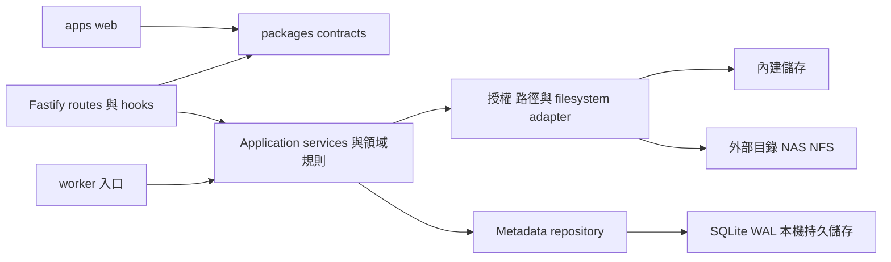
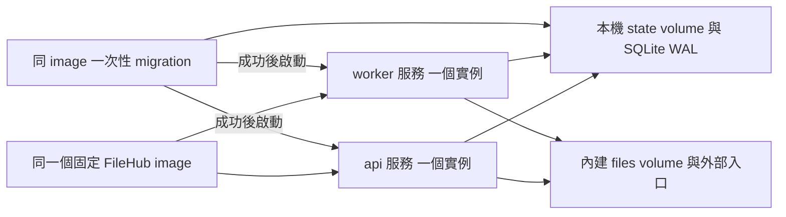

# FileHub 架構規劃

> 驗證報告與原始擷取保留本機，未隨原始碼發佈；文中「本機」路徑僅作歷史定位，不能視為新 checkout 已有的證據。

新版 FileHub 採 Node.js、TypeScript 與 Fastify，前端使用 React、TypeScript 與 Ant Design；Vitest 負責單元與整合測試，Playwright 負責實際 HTTP 與瀏覽器操作驗證。管理資料庫為 SQLite（WAL），正式部署在單台 Linux 主機，以 Docker Compose 將同一 image 分成 `api`、`worker` 兩個服務。系統同時支援內建儲存及外部既有資料夾／NAS／NFS。

P0–P10 共 70 份工作已完成，目前程式版本 `0.41.0`／schema 13。進度依[主計畫](IMPLEMENTATION_PLAN.md)，環境界線依跨階段矩陣（本機 `docs/validation/P6-matrix.md`）。Linux 寫入，Windows 開發唯讀。

P10.1 新增 H 圖像品牌及 320px 工具列修正。P10.2 依[白色畫布規格](docs/decisions/P10-white-canvas.md)調整集中 theme 與 CSS。本機 8088 依 P10.7 交付 0.40.18（本機 `docs/validation/P10.7.md`）。P10.8 的內網 HTTP 與路徑部署使用同一 schema 13，安裝見[部署操作](docs/operations/deployment.md)。

原始計畫到目前功能、明確縮限與發行前置的對照見[2026-11-01 驗收準備稽核](docs/reviews/acceptance-readiness-2026-11-01.md)；不以早期 API 命名草案或 Windows 唯讀結果代替目前 Linux 能力驗證。

2026-10-30 新增[主計畫 P8](IMPLEMENTATION_PLAN.md#p8-file-browser-畫面還原)，依[全畫面審查](docs/reviews/filebrowser-visual-reference.md)改以 File Browser 為視覺基準，P8.1–P8.9 的共用視覺、殼層、三檢視、情境操作、對話框／預覽、公開頁、管理分類、非模態工作浮卡及整體比對／完整回歸已完成，正式 image、schema 12 升級／舊快照回復與 8088 交付已完成，依 P8.10（本機 `docs/validation/P8.10.md`）。React／Ant Design 與後端架構不變；P8.3 已新增 mosaic 偏好與 schema 13 migration，保留 list／thumbnails 及筆數，其餘安全與資料契約維持。

## 1. 決策狀態

| 項目 | 狀態與範圍 |
| --- | --- |
| 後端 | 使用者已確認 Node.js＋TypeScript＋Fastify |
| 前端 | React `19.3.1`／TypeScript／Ant Design `6.6.8`；檔案工作空間、設定／分享／垃圾桶頁與工作浮動面板，另有獨立公開分享及服務概覽。Vite 正式產物由 API 同源提供；見 [DESIGN](DESIGN.md)及[P1.4 決策](docs/decisions/P1-workspace.md) |
| 視覺方向 | P8 已完成本機 Roboto／Material、File Browser 構圖、三檢視、搜尋、情境操作、安全預覽及工作浮卡。P9 的[視覺層級與一致性提案](docs/reviews/p9-design-review.md)已備妥，P9.1–P9.9 已完成驗證與正式交付；仍用現有 React／AntD、集中 token 與 controller，不改公開契約或 DB。現行外觀依 DESIGN／P10.2／P10.3，正式交付及第一行／全頁稽核依 P10.7，P10.6 保留歷史；後續順序依主計畫 |
| 測試 | Vitest 與 Playwright；Windows／隔離 Debian 核心及 Chromium 三視窗已驗，Linux Compose 分開記錄；CI 設定與 hosted 執行結果分開 |
| 儲存 | 使用者已確認內建儲存與外部資料夾兩種用途；外部檔案可能被其他程式修改 |
| 程式組織 | 本規劃採單一儲存庫與模組化單體，使用 workspace 邊界管理前端、後端與公開契約 |
| 資料庫 | 已確認 SQLite WAL／better-sqlite3 `13.0.3`；Windows 與 P0.5 Linux 雙服務正式 adapter 均實測 SQLite `3.53.4` |
| ORM／migration | 使用者已確認 Drizzle ORM `0.45.4`、Drizzle Kit `0.31.11`；Kit 產生 SQL，正式環境使用 ORM runtime migrator |
| Node.js | 使用者已確認 `24.22.1`，24 LTS 分支 |
| Package manager | 使用者已確認 pnpm `12.16.0`；P0.1 已建立 workspace、單一 `pnpm-lock.yaml` 與精確 `packageManager` |
| Schema／其餘版本 | P0.1 已選 TypeBox `1.4.3`／Fastify provider `6.3.0`、TypeScript `6.0.3`、Fastify `5.12.7`、Vitest `5.0.5` 等，版本與理由見 [P0 決策](docs/decisions/P0-tooling.md)；image digest 見 [P0.5 部署決策](docs/decisions/P0-deployment.md) |
| 正式部署平台 | 使用者已確認第一版為單台 Linux 主機，使用 Docker Compose |
| 執行拓樸 | 同一固定 image 的 `api`、`worker` 各一實例，migration 一次性 gate。P0.5 固定 Debian Bookworm／linux/amd64、UID/GID 1000、512 MiB／1 CPU／128 PIDs 與 local named volumes；實測環境及掛載邊界見驗證摘要 |
| 其他能力 | 入口／scope 依 P1.2；P3 是自有 upload session，不宣稱 TUS；P2 私有 trash、P5 跨入口 move／ZIP、P4 有界搜尋，尚無完整內容索引 |

已確認的技術不再並列 Go／FastAPI 作為新版後端候選；File Browser 的 Go、Vue、bbolt 等描述仍屬參考來源事實。

既定工具鏈持續作 P0 基線；歷史驗證分見 P0.1（本機 `docs/validation/P0.1.md`）–P0.6（本機 `docs/validation/P0.6.md`）。P0.7（本機 `docs/validation/P0.7.md`） 建立共用驗收、乾淨 Linux 核心／Chromium、正式 Compose 與 workflow 靜態檢查；產品操作依主計畫各份驗證。[P5.5](docs/decisions/P5-fault-acceptance.md) 限定 NFSv3 唯讀來源與 exporter 暫停／恢復；GitHub hosted jobs、其他瀏覽器及未列明 NAS／NFS／SMB 情境未驗。

## 2. 目錄與依賴方向

私有 UI 的 Workspace 持有上傳／工作 controller；WorkspaceShell 只管理版面及 header slot，SearchControls 經 portal 顯示於頂列，仍由 FilePanel 擁有、結果留 main。FilePanel 協調 listing、version 綁定選取及動作，FileListing／ResourceActions／SelectionToolbar 負責呈現；SearchControls 保留暫時搜尋與兩種範圍，API 契約及後端授權不因選單或小螢幕而改變。

WorkspaceNavigation 提供真實入口／scope 與全域流程，手機 Drawer 收合後才執行選項；AccountMenu 提供明確展開狀態、設定、另開分頁的服務狀態及登出。分享管理使用 view=shares，垃圾桶使用 view=trash 與 entry；主導覽採原生連結並保留檔案 query。大型清單改完整頁，建立分享、還原與預覽維持短 Modal；兩者不持有檔案或背景工作生命週期。

SettingsPage 使用根 query 的 view=settings／section，與檔案上下文共存；只有管理員的管理分類才讀 /api/admin。useLocation 的共同 guard 涵蓋分類、側欄、返回及登出；history.state 新增整數索引以復原取消的 popstate，不保存表單或秘密。儲存中拒絕離開，dirty 使用一致確認，整頁離開使用 beforeunload。SessionApp 與 Workspace 跨私有頁保持 mounted，控制器不跟設定分類重建。

TaskDrawer 以非模態 portal 訂閱上述兩個 controller 並控制呈現，收合不 dispose／取消／重送。新選檔或恢復項目可開啟，進度及完成不強制重開；目的地 Modal 尚在時暫時收合浮卡，保留 afterClose 焦點語意。上傳百分比依 committed offset，已送出 bytes 另列；未知結果及 needs_review 繼續由既有 controller／後端規則處理。原檔與 File 仍由原控制器管理，工作 storage 仍只有目前 owner 的 UUID。

前端 `features/operations/` 由 Workspace 擁有 clipboard／工作 controller，與會因導航重建的 FilePanel 分開；背景結果只 reload listing。公開能力、逐項結果與 UUID 回查不依賴私有 DB entities，瀏覽器只保存 owner 對應的最多 50 個工作 ID。介面與取消／重連規則見 [P5.4 決策](docs/decisions/P5-workspace.md)。

```text
FileHub/
├─ apps/
│  ├─ web/                       React 與 Ant Design
│  │  └─ src/                    路由、功能頁、API client、共用元件
│  └─ server/
│     └─ src/
│        ├─ app.ts               Fastify application factory
│        ├─ server.ts            API 程序組裝與 listen
│        ├─ migrate.ts           一次性 migration CLI
│        ├─ runtime.ts           listen／有界關閉與失敗清理
│        ├─ worker.ts            worker 服務的背景工作啟動入口
│        ├─ worker/              idle loop、狀態取樣與容器 heartbeat
│        ├─ lifecycle/           共用關閉期限與 signal callbacks
│        ├─ config/              執行設定與驗證
│        ├─ plugins/             共用 Fastify plugins 與 hooks
│        ├─ modules/             帳號、入口、檔案等功能模組
│        ├─ storage/             路徑、檔案系統與授權邊界
│        └─ persistence/         metadata adapter 與 migration 接合
├─ packages/
│  └─ contracts/                 對外 request／response schemas、DTO、錯誤代碼
├─ tests/
│  ├─ http/                      真實 TCP 與編譯產物子程序測試
│  ├─ e2e/                       Playwright 與隔離服務 fixtures
│  └─ system/                    平台、Docker、NFS、跨磁碟及程序故障情境
└─ docs/                         需求、決策、驗證與 File Browser 研究
```

以上為完整預定布局。P0.6 已有 web 的 `main.tsx`、`app/`、`theme/`、`lib/api.ts`、CSS、index.html／Vite 設定、server `plugins/web.ts` 與 `tests/e2e`／Playwright config；先前 worker／lifecycle／persistence 與 Compose 維持。SQL／metadata 在 `apps/server/drizzle/`，單元／整合在 `apps/*/tests/`，TCP 在 `tests/http/`，程序／Compose 在 `tests/system/`。其他功能模組依後續階段建立。



`apps/web` 只引用瀏覽器可用的公開契約，不引用 `apps/server`。`contracts` 不含 ORM entities、實體主機路徑、session secrets、Fastify instance 或 Node 檔案 I/O。後端 routes 轉換 HTTP 輸入與回應，再呼叫服務；服務透過必要的 adapters 存取資源，不依賴瀏覽器或 HTTP request 物件。

共用 schema 採 TypeBox，TypeScript 型別由同一份契約推導，後端以 Fastify Type Provider 串接執行期驗證；P0.2 已建立 error／health schemas。避免手動維護兩份互相漂移的 DTO；前端可顯示後端回傳的 capabilities，伺服器仍逐次授權。

前後端使用 TypeScript strict 檢查，外部未驗證資料以 `unknown` 等明確邊界處理，避免用 `any` 跳過驗證。型別檢查獨立於轉譯、測試與 build；跨 workspace 透過公開匯出存取，不深入引用另一個 application 的內部檔案。

## 3. Fastify 組裝與生命週期

- `app.ts` 的 factory 組裝 Fastify、health、error handlers 與明確注入的 identity routes，借用 readiness probe、不 listen／開 DB；明確指定 webRoot 才註冊靜態 plugin。正式 main 使用模組相對的 web build；缺少完整產物時拒絕啟動並清理 DB。
- `runtime.ts` 已提供 `listenApp` 與 `closeApp`；啟動失敗清理 app，重複關閉共用同一 Promise。期限內先讓在途請求完成，超時關閉 HTTP connections 並拒絕，不宣稱已終止外部 I/O。
- `server.ts` 的 `main` 負責解析設定、建立並擁有 DB connection、注入 readiness、listen 與 signal handlers；正常關閉或啟動失敗都清理自身 DB，不關閉借用 fixture。直接執行由 `import.meta.main` 判斷，錯誤不回顯路徑或設定值。
- `worker.ts` 提供獨立 async main，解析設定並擁有自己的 DB，啟動前驗相容性，Compose 啟用時等待初始 heartbeat 發布；呼叫端須 await。執行 readiness loop 與 P3 有界上傳維護，不建立 HTTP listener；Linux OperationExecutor 執行持久 copy／move／archive，維護與 owner proof 依 P5 決策。
- `lifecycle/shutdown.ts` 供 API／worker 共用關閉 Promise、期限與 SIGINT／SIGTERM 註冊／移除。worker close／done 先停止 loop 再關 DB；各入口提供內部 diagnostics getter 供維運／測試取樣，不放進公開 HTTP DTO。
- 匯入模組不開埠、不啟動全域工作、不建立正式資料庫或掃描使用者檔案。
- resource ownership 必須明確：誰建立 app、連線、工作池、計時器，誰負責關閉。注入的外部資源與 application 自有資源分開管理，避免測試誤關共享 fixture 或重複關閉。
- 啟動失敗清理已建立資源；關閉時先停止接新工作，依有界期限完成／標記在途工作，再關閉依賴。終止期限不代表核心中阻塞的 I/O 已取消。

功能模組以 Fastify plugin 註冊相關路由與 hooks，明定公開、登入及管理員路由的範圍，測試 plugin 封裝與註冊順序，避免認證 hook 漏套。請求格式由 schema 驗證；身分、入口授權、檔案是否存在及執行前競態檢查由適當 hooks／services 處理。資料庫查詢不放進初始 schema validator。

回應使用明確公開 DTO／response schema，不直接序列化資料庫 entity。P0.2 錯誤僅含穩定 `code`、固定訊息、有限 `details.location` 及伺服器產生的 `requestId`；預設停用原始請求日誌，不輸出 stack、URL、主機路徑、驗證輸入或秘密。需要更細診斷時另定遮蔽政策。[Fastify testing](https://fastify.dev/docs/latest/Guides/Testing/)、[encapsulation](https://fastify.dev/docs/latest/Reference/Encapsulation/)、[validation and serialization](https://fastify.dev/docs/latest/Reference/Validation-and-Serialization/)

`/health/live` 回 200、`status: ok`；`/health/ready` 依 probe 回 200／503、`status: ready | not_ready`，503 是 health 狀態回應。P0.3 起 factory 缺 probe 預設未就緒，正式 API 每次驗 DB 設定、schema revision 與 migration history。檢查有 timeout／AbortSignal，但不能搶占同步 SQLite 或核心 I/O。契約及 DB 接入分見 [P0.2 決策](docs/decisions/P0-api-lifecycle.md)、[P0.3 決策](docs/decisions/P0-persistence.md)。

## 4. 功能模組與公開契約

下表為完整規劃；P1 已落地 identity、entries、files 的讀取，寫入、upload／operation／trash／preview／search／share 及完整管理依後續階段實作。

| 模組 | 職責及依賴 |
| --- | --- |
| identity | 帳號、密碼、可撤銷 session、登入節流、公開 capability 資料 |
| entries | 內建／外部入口、顯示名稱、啟用狀態及使用者 grant |
| files | metadata、列表、串流下載、新增、改名；使用共用 storage 邊界 |
| uploads | 上傳 session、暫存、offset、完成發布、取消及到期清理 |
| operations | 遞迴複製、跨磁碟搬移、封存等持久工作及逐項結果 |
| trash | 回收位置、原路徑、還原授權與衝突；永久刪除另設能力 |
| previews／search | 有界的衍生內容與搜尋；與一般檔案操作套用相同授權 |
| shares | 分享來源、期限、密碼、撤銷及公開存取範圍 |

跨模組重用服務的公開介面，不繞過服務直接修改另一個模組的 tables。repository 只在需要持久化的地方建立；不為每個純函式再包一層通用框架。

API 領域參考[改寫藍圖](docs/filebrowser-study/07-filehub-rewrite-blueprint.md#5-建議的-api-契約草案)，其 `/api/v1` 為早期候選。已落地 P1 使用 `/api/session`、`/api/entries` 及 `/api/entries/:entryId/files|metadata|download`，以 routes／公開 contracts 及 P1 決策為準。後續切片先固定 request、response、錯誤、權限與副作用，再接前後端。

## 5. 儲存入口與檔案真值

每個入口具有穩定的 `entryId`、內部實體根路徑、`managed`／`external` 類型、啟用狀態與能力；對外資源用 `entryId + relativePath` 表達。主機掛載由 OS／Docker 管理，FileHub 管理入口與授權。

| 項目 | 內建儲存 | 外部目錄 |
| --- | --- | --- |
| 來源 | FileHub 管理的資料目錄／volume | 管理員掛入的既有本機目錄、NAS／NFS |
| 上傳 | 依入口能力允許 | 依掛載可寫與入口授權允許 |
| 內容真值 | 實際檔案系統；FileHub 保存操作管理資訊 | 實際檔案系統；外部程式可隨時修改 |
| 身分與快取 | 識別策略於實作定義 | 同一路徑可換成另一個檔案，不能把 path 當成永久內容 ID |
| 垃圾桶／暫存 | 根據容量與政策安排 | 需考慮同檔案系統、唯讀掛載、外部可見性及跨磁碟成本 |

兩種類型先共用 filesystem adapter；沒有已確認的雲端物件儲存需求，不預先實作 provider 生態。metadata DB 保存帳號、授權、session、任務、分享等管理資料；原始檔案不轉存成 DB blobs，也不要求第一版先建立完整檔案索引。

所有檔案入口走相同路徑正規化、來源／目的地授權、symlink／junction 與實體範圍檢查。檢查與實際 I/O 間仍有競態，必須依支援平台和本機威脅模型選擇策略並實測；不能宣稱字串 prefix 檢查已提供完整隔離。

## 6. 同步操作與背景工作

worker 同步檢查正式 DB readiness，預設每 1000ms 一輪，可設定 50–60000ms。初始未就緒即失敗；執行中未就緒轉 unavailable，恢復後回 idle。Linux 在就緒時另按 60000ms 預設間隔進行有界上傳維護，每批最多四筆，詳見 [P3.4](docs/decisions/P3-upload-maintenance.md)。info 記狀態變化、debug 記每輪；Compose 將狀態原子發布到私有 tmpfs，healthcheck 核對 freshness、PID／starttime 與 DB。P5.1 加入獨立 operation executor，借用 worker 原連線；heartbeat 不等於持久工作 lease，詳細狀態／限制見 [P5 決策](docs/decisions/P5-operations.md)。

新增資料夾及一般單檔改名先採有界同步請求；遞迴複製、跨磁碟搬移、ZIP 及大量批次處理建立持久 operation。同步操作仍需名稱／衝突驗證、明確錯誤與適用的稽核，不要求每次都建立通用背景工作。

operation 保存發起者、來源／目的地、狀態、逐項結果與可恢復資訊。狀態為 `queued → running → succeeded | partial | failed | cancelled | needs_review`，取消執行中工作先為 `cancelling`；舊 owner 已停止且所有 item 未開始才轉 `interrupted`，允許明確 retry。API 與 worker 共用服務，執行前重新檢查授權及資源狀態。P5.2 已開放 Linux copy／move；manifest 與 guard helper 驗內容，跨裝置搬移先驗副本再回收來源。P5.3 已開放 ZIP；工作 UI 由 P5.4 接續，詳見[操作](docs/operations/background-operations.md)。

API 與 worker 為獨立程序，工作領取、lease、取消、目的地協調及重試使用 SQLite 持久紀錄與短交易協調；各程序自己的記憶體鎖不能保護跨程序操作。第一版採一個 API、一個有界 worker executor，工作紀錄同時承擔佇列狀態，不引入額外 Redis 或資料庫 server。

工作領取以交易與條件更新保證一次只有一個有效 owner，記錄 lease 及執行嘗試版本，進度更新節流。API 同步寫入與 worker 寫入共用來源／目的地資源協調，涵蓋目錄子樹衝突。lease 失效後，舊 owner 的狀態更新必須被拒絕；在途檔案 I/O 不一定已停止，重新領取前須確認舊執行已終止／資源已釋放或轉為需處置狀態，不能只因 lease 到期就重複操作相同路徑。

取消表示停止能停止的後續工作並回報已完成項目，不承諾自動回滾。重啟時先辨識未完成工作，不能盲目重跑搬移／覆寫。DB 狀態更新採短交易，檔案複製不持有長 DB 交易；DB 與檔案系統沒有共同的原子交易。

## 7. Node.js 檔案與資源管理

P5.3 ZIP 使用受保護的 state 檔與持久 artifact record，完整 bytes／witness／來源授權驗證後原子提交成功；24h TTL／8 GiB 管理配額、guard proof 清理與下載政策見 [ZIP 決策](docs/decisions/P5-archives.md)。產物不進 SQLite BLOB，完整原檔／產物備份見 [P6.3](docs/decisions/P6-maintenance.md)。

- 使用適用的非同步檔案 API 及串流，限制記憶體緩衝、上傳大小、掃描深度、並行數、開啟檔案數與工作佇列。
- 下載／上傳考慮 backpressure、client 斷線、串流錯誤與暫存清理，避免將整個大檔讀入記憶體。
- CPU 密集的壓縮、縮圖或解析需評估 worker threads／獨立程序／外部工具與資源上限；具體選型在功能切片中決策。
- `async`、AbortSignal 或 HTTP timeout 不保證中止核心中卡住的 NFS I/O；失去某入口時，管理功能能維持到何種程度，需在 P0 定義隔離與降級目標，再以環境測試驗證。
- better-sqlite3 為同步 driver，交易 callback 不使用 `async`／`await`；交易與鎖定納入 event loop／API 延遲評估。P0 驗證忙碌等待與長查詢的有界處理，不能僅因用了 Promise 就宣稱沒有阻塞。

上傳暫存與 finalize 需定義大小、checksum 政策、過期及發布前重新授權。只有在實際平台和檔案系統成立時才使用同檔案系統 rename 的原子語意；跨磁碟要用可追蹤的搬移策略。[Node.js event loop 與 worker pool](https://nodejs.org/en/learn/asynchronous-work/dont-block-the-event-loop)、[filesystem API](https://nodejs.org/api/fs.html)

## 8. 資料庫與部署邊界

2026-10-27 已定案：SQLite（WAL）與單台 Linux Docker Compose；`api`、`worker` 使用相同版本／digest 的 image，分成兩個常駐服務，各執行一個實例。兩服務均採上述已定案的 Node、better-sqlite3 與 Drizzle 版本；P0 完成依賴鎖定及實測。Windows 可作開發環境，其結果不能代替正式 Linux／掛載環境驗收。

### 8.1 SQLite 與管理資料

SQLite 保存帳號、grant、session、upload、operation、分享及垃圾桶等管理狀態；原始檔案仍由 filesystem 管理。第一版只支援 SQLite adapter，不為 PostgreSQL 預先維護另一套 schema／driver。若未來需要多主機或量測到持續寫入競爭，再另立遷移決策，不承諾只換連線字串。

DB 與 WAL／SHM 位於同一個本機持久目錄，由兩服務共用；該 volume 必須使用適合 SQLite 鎖定與共享記憶體的本機檔案系統，不放在 NFS／SMB，也不使用網路 volume driver。WAL 可讓讀寫並行，仍只有一個 writer。P0 固定 busy handling、checkpoint、耐久性設定及各連線初始化，使用短交易與可觀察、有界的忙碌處理；檔案複製不持有 DB 交易。[SQLite WAL](https://sqlite.org/wal.html)

P0.3 連線定案為 WAL、外鍵 ON、`synchronous=FULL`、`wal_autocheckpoint=1000`；busy timeout 預設 100ms、允許 0–1000ms，不另加重試。等待會阻塞 Node event loop，SQLite 的等待設定不保證相同 wall-clock 上限；Windows 實測與限制見 P0.3 驗證（本機 `docs/validation/P0.3.md`）。autocheckpoint 不是 WAL 大小硬上限。runtime 只開既有 DB，migration 才建立 state／啟用 WAL；目前 schema revision 13，含 schema／migration、identity／entries／grants、write／trash／uploads、operations、shares 及 preferences 管理表。

better-sqlite3 `13.0.3` 上游內含 SQLite `3.53.4`；P0 在兩服務的正式產物核對實際引擎版本與 journal mode，記錄結果。WAL-reset 修補的最低要求仍為 SQLite 3.51.3 或更新版本，或有明確上游修補證據的受支援 backport；選定套件不等於執行時核對已通過。[SQLite WAL 第 11 節修補說明](https://sqlite.org/wal.html)

Drizzle schema、query builder 與必要的參數化 SQL 位於後端 persistence 邊界；工作 claim／lease 保留明確條件更新與短交易，不由 ORM 代替資源協調。公開 API contracts 與 DB schema 分開。

### 8.2 兩個服務與持久資料

| 項目 | `api` | `worker` |
| --- | --- | --- |
| 執行入口 | 編譯後的 `server.ts` 入口 | 編譯後的 `worker.ts` 入口 |
| 責任 | 同源 SPA／API、session、授權、查詢、同步小操作及串流 | 持久工作領取、長時間檔案操作、狀態與恢復資訊 |
| Image | 同一個固定 image 版本／digest | 與 API 完全相同，不另外建另一套業務程式 |
| 對外埠 | 僅 API 發布網站入口 | 不發布對外 HTTP 埠 |
| 資料與身份 | 共用 state、內建檔案及適用的外部掛載 | 入口路徑、必要 UID／GID 與存取能力需與 API 一致 |
| 健康狀態 | 分開表達程序存活、DB／schema 就緒 | 分開檢查程序、工作循環及持久狀態存取 |

以下 state／files／cache 路徑已在 P0.5 Compose 落地；外部掛載範例為 `/mounts/example`，P1.2 起由入口 CLI 登錄既有目錄及 stable entryId：

| 儲存 | 容器路徑 | 保存原則 |
| --- | --- | --- |
| 本機 state volume | `/data/state`，DB 為 `/data/state/filehub.db` | DB、WAL／SHM、必要持久設定及有界 ZIP 產物；兩服務具必要讀寫權限，另預留產物／WAL 容量 |
| 內建 files volume | `/data/files` | 原始檔案與適用的回收／暫存內容，依後續政策細分 |
| 可重建 cache | API 程序記憶體；`/data/cache` volume 保留供未來使用 | P4.3 LRU 最多 32 項／16 MiB，重啟清空、按需重建；不當作永久原檔 |
| 外部入口 bind mounts | `/mounts/<entryId>` | Linux 主機先掛載，再以一致路徑掛入需要存取的服務；保留唯讀／可寫邊界 |



P0.6 已由 Fastify 的 `plugins/web.ts` 提供正式 SPA：`/`、`/index.html` 及帶雜湊 assets；HTML no-store、assets immutable，未知 API／檔案仍 JSON 404，不使用全域 fallback。TypeScript outputs 放 dist，Vite outputs 放 `apps/web/build`，Docker runtime 帶入相同 build。開發用 `pnpm dev:web` 的 loopback Vite proxy，正式模式與瀏覽器驗證皆使用 Fastify 產物。[前端決策](docs/decisions/P0-web.md)定義 client 的 schema／取消／錯誤與 fixture 邊界。

`/FileHub/` 與根網址共用正式產物與路由。Vite 使用相對資產路徑，Fastify 在路由前移除精確的 `/FileHub/` 前綴，依原始路徑設定登入與分享 Cookie 的範圍。反向代理保留前綴。部署來源仍以協定、主機與埠驗證，啟用內網 HTTP 須設定 `FILEHUB_ALLOW_LAN_HTTP=true` 與對應的 `FILEHUB_PUBLIC_ORIGIN`。

### 8.3 啟動、升級與備份

Migration 是同 image 的一次性命令／服務，不算第三個常駐服務。首次啟動在 migration 成功後才啟 API／worker；Compose 可用 `service_completed_successfully` 表達門檻。schema 不相容時拒絕就緒，不讓兩服務各自競爭 migration。[Compose startup order](https://docs.docker.com/compose/how-tos/startup-order/)

P0.3 已提供 `pnpm db:migrate`，由編譯後 `migrate.ts` 使用正式連線與 Drizzle runtime migrator，固定由模組位置尋找 SQL／metadata，不依賴 cwd。執行前核對已套用紀錄是本版 migration 的完整已知前綴，並核對 hash／時間戳／revision；不接管未知 DB、不降版、不修改已套用 SQL。P0.5 已驗 Compose gate：migration 失敗兩服務不啟動。

Drizzle Kit 在開發階段由 TypeScript schema 產生 SQL／migration metadata，審查並通過空 DB／舊版 fixture 升級測試後提交。正式 image 包含已產生的檔案、編譯後的 migration 入口與 Drizzle runtime migrator；執行時共用已定案 driver 與連線初始化。正式環境不執行 schema `push`、不產生 migration，也不要求保留 Kit。

第一版升級採協調式維護：停止接收新修改／工作，關閉兩服務並確認在途狀態，完成可恢復備份，再執行一次 migration、啟動相同版本 API／worker 並驗 readiness。不提供混合版本滾動升級保證；回退需檢查 schema 與原檔相容性。

SQLite 備份使用其 online backup 機制，或在兩服務與其他 DB 寫入者皆停止後取得一致副本；不得只複製仍在使用中的 `.db`，也不手動刪除 WAL／SHM。DB 備份不等於檔案內容備份，整體還原另包含必要設定、內建檔案及外部目錄；若外部程式仍在寫入，須另確保儲存端的一致性。P0 建立 DB 還原 smoke，功能階段補齊工作與檔案狀態恢復驗證。[SQLite backup API](https://sqlite.org/backup.html)

P0.5 使用固定 digest 的 Debian Bookworm／amd64 image，三角色 UID/GID 1000、read-only rootfs、drop ALL、no-new-privileges；每角色 512 MiB／1 CPU／128 PIDs。API 預設發布主機 `0.0.0.0:8088`。跨機登入驗證設定的單一 HTTPS 來源，或明確啟用的內網 HTTP 來源。worker heartbeat 位於各容器私有 `/run/filehub` tmpfs；不能用連 DB 成功替代循環 freshness。外部入口健康依後續模型獨立呈現，不把一個 NFS 離線等同整個服務死亡。

[P6.3 完整維護](docs/decisions/P6-maintenance.md)提供 Linux filehub-full-v1 快照及全新目標還原，包含設定、所有入口及必要 state；停機 flock 與 owner guard proof 共同檢查，外部寫入仍需停寫。可攜還原重綁實體識別，未完成工作不重播；--preserve-schema 供舊快照搭配原 image 回復。DB-only CLI 仍是較窄的管理資料工具。[部署決策](docs/decisions/P0-deployment.md)、[可執行操作](docs/operations/deployment.md)、實測平台／限制（本機 `docs/validation/P0.5.md`）記錄固定 digest、掛載、健康與回復範圍；Docker Desktop 的結果不擴大為裸機或真實 NFS 故障保證。

## 9. 測試與實作起點

| 層級 | 工具 | 可支持的結論 |
| --- | --- | --- |
| 單元 | Vitest | 路徑與權限規則、狀態轉移、衝突策略、純資料轉換 |
| 整合 | Vitest＋Fastify.inject＋隔離 FS／正式 SQLite adapter | 實際路由、hooks、schema、session 及檔案／資料庫副作用 |
| E2E | Playwright＋啟動中的服務 | 真實 HTTP、瀏覽器操作、登入、上下載、預覽及畫面狀態 |
| 環境 | Vitest／程序或容器 harness；必要時 Playwright | 已選平台的重啟、掛載、權限、跨磁碟、NFS 故障與恢復 |

`inject` 不覆蓋 TCP、代理或程序生命週期；瀏覽器通過也不能代替 NFS／多程序驗證。每份測試隔離資料、帳號、埠及 cleanup ownership，關鍵副作用使用真實暫存檔案和 DB；mock 只用於有界的替身或錯誤注入。

P0.7 共用 `tests/helpers/` 的 runner-independent 目錄／Node 子程序／環境 helpers，Vitest 與 Playwright 在各層註冊清理 hooks。目錄保存 realpath／device／inode 並拒絕 symlink／被替換目錄；建立者先關閉 DB／程序再清理。`check` 完整 build 一次後跑原生驗收，`verify:core` 加 Chromium，`verify:p0` 再建正式 image／跑 Compose。workflow 設定 Windows Server 2022／Ubuntu 24.04 core、Ubuntu Compose；本機 Linux CI image 不掛主機程式或 socket，獨立安裝 Linux native dependencies。完整命令與平台／資源界線見[決策](docs/decisions/P0-ci-and-fixtures.md)及[操作檢查表](docs/operations/p0-checklist.md)。

WAL／鎖競爭及 API／worker 協調以同一份 file-backed SQLite、獨立連線與實際雙程序驗證，不能用 `:memory:` 代替。必要案例包含有界 busy handling、原子領取、失去 lease 後的舊 owner 更新、重啟中的部分完成、migration 失敗阻擋啟動、備份還原與掛載身份一致性；已落地功能的當次結果依 P6 矩陣（本機 `docs/validation/P6-matrix.md`）；未列平台與故障仍保留界線。

P0 依已定案工具鏈建立 pnpm workspace／lockfile，完成其餘依賴版本選擇與乾淨安裝；建立 contracts、可測試的 Fastify factory、最小 API、SQLite WAL／Drizzle migration／還原 smoke、同 image 雙服務啟停、Vitest 分層與 Playwright fixture。依[主計畫](IMPLEMENTATION_PLAN.md)從 P0.1 起逐份驗證／commit，完成 P0 整體啟停與清理驗收後，再進 P1 的登入與唯讀瀏覽。測試工作流程見 [CONTRIBUTING.md](CONTRIBUTING.md)。

## P1.1 的 identity 邊界

`IdentityService` 借用正式 DB，factory 不開關連線；main 注入，CLI 每次建立並關閉自己的連線。session 使用 32-byte opaque token／DB SHA256、HttpOnly Cookie、12 小時期限與逐請求帳號檢查；改密碼／停用／登出可撤銷。Origin／CSRF 防護、KDF／節流與管理入口見 [P1 決策](docs/decisions/P1-session-and-access.md)及[操作](docs/operations/identity.md)。P1.1 migration 從 schema 1 升至 2，初始 SQL 不改。

## P1.2 的入口與 storage 邊界

`EntryService` 借用 DB，提供入口、grant 與純讀取授權；root／inode／祖先資料不進公開 DTO。`GET /api/entries` 回可見 scope 與唯讀能力，CLI 才能註冊／授權。`storage/scoped.ts` 開啟受控資源，由呼叫端關閉；Linux pin 住 root／每層 directory fd 並拒絕 symlink，Windows 用前後 identity 檢查及 file handle。grant 書寫不持有 FS I/O 的 DB transaction。schema 3 新增 entries／grants，細節與限制見[決策](docs/decisions/P1-entries-and-scoped-paths.md)與[操作](docs/operations/entries.md)。

## P1.3 的讀取與串流

`FileService` 使用 `EntryService`／scoped storage，不直接持久化檔案索引。列表最多掃描 5000、每頁 100，8 個並行 stat、每程序 4 個 FS 操作／下載；掃描變更以版本衝突要求刷新。HTTP plugin 擁有本 app 建立的下載生命週期，於正常／取消／HEAD／關閉清理，factory 不關借用 DB 或 caller 的直接資源。下載只作附件、固定 MIME／nosniff、支援單一 Range；metadata digest 為 weak validator。完整邊界見[讀取決策](docs/decisions/P1-files-read.md)。

## P1.4 的瀏覽器狀態

首頁以 session API 還原身分；user／CSRF 留 React 記憶體，401 清受保護畫面，登出由 server 撤銷。query／History 管理 entry／relative path／sort／version page，Table 選取跟路徑與版本綁定；AbortController 加請求 key／代次防止舊結果覆蓋。目錄採單層載入與 scope 麵包屑，不遞迴掃樹。大檔案交原生 attachment，不轉整檔 Blob；正式 endpoint 再授權。見 [P1.4 決策](docs/decisions/P1-workspace.md)。

## P1 的完成邊界

正式 CLI、獨立 API、SQLite WAL 與三視窗 Chromium 已串起管理員／受限帳號的唯讀流程；登出重播、撤權、離線／恢復與拒絕無邏輯資料／原檔變更均有驗收，schema 2 升級保留身份資料。操作見[唯讀工作空間](docs/operations/read-only-workspace.md)，結果見 P1.5（本機 `docs/validation/P1.5.md`）。P1 沒有檔案寫入、持久 job、完整管理 UI、真實 NAS 故障或完整原檔備份保證；依主計畫在後續階段驗證。

## P2.1 寫入協調實作

`WriteCoordinator` 借用正式 DB，BEGIN IMMEDIATE 內檢查帳號／入口與活動子樹 reservation，最多 128 活動、10000 總意圖。prepared／applying／needs_review 會阻擋重疊操作；owner／generation 條件更新拒絕舊 handle。交易不含 FS I/O，未證明 owner 結束前不得自動解鎖；公開 DTO 不含 private payload／evidence。名稱及不覆寫政策見 [P2 決策](docs/decisions/P2-write-coordination.md)。

## P2.2 同步寫入實作

API main 擁有 `MutationService`，關閉時先等待操作／guard，再關 DB；factory 只借用。同步 mkdir／rename 共用 reservation、durable intent 與 Linux narrow helper，來源／目的地皆重新授權，既有名稱不覆寫。入口／grant opt-in，Windows 開發唯讀；公開 UUID 狀態查詢不含私有 payload。私有 `.filehub` exclusive 初始化並核對 control inode，未認領的同名目錄不採用。規則與平台限制依 [P2.2 決策](docs/decisions/P2-synchronous-writes.md)。

## P2.3 回收實作

`TrashService` 共用 MutationService 的 admission、guard、意圖與 reservation；trash_items 的 prepared／terminal 與對應意圖在同一短交易。資料留原入口 .filehub/trash，同 FS rename、沒有複製或永久刪除 fallback。還原重驗目前授權與 witness，列表有界且只檢查當頁 payload，異常不可還原。規則依 [P2.3 決策](docs/decisions/P2-trash.md)，操作依[小型寫入](docs/operations/writes.md)。

## P2.4 受控恢復

API／worker 可共用 `recoverWrites`，正式 CLI 為 write-recover。先取得舊 owner 的 OFD proof、持有本次 guard，再以 owner／generation fencing 更新紀錄；只觀察來源／目的 witness 與 directory durability，不重播檔案副作用。busy／缺 guard 不偷鎖，未知結果保留 reservation。trash terminal 與 intent 共用短交易；詳細契約依 [P2.4 決策](docs/decisions/P2-recovery.md)。

## P3 上傳 session

公開自訂 FileHub upload session v1，契約與限制見 [P3 決策](docs/decisions/P3-upload-protocol.md)。catalog 以同一正式 SQLite 短交易保留檔案大小與 session 配額，已提交 offset／chunk manifest 持久化；bytes 留在入口私有 staging，不放資料庫。P3.2 的 UploadService 擁有接收／hash 的 OFD guard、admission 及 close；factory 只借用，API main 先等 uploads、再 mutations、最後關 DB。

receiver await 小段寫入以 backpressure 接收，fsync／授權後才提交 offset；finalize 串流驗 manifest 與全檔 hash，再借用 P2 rename 原語發布。內部 publication intent 及 upload terminal 同交易，恢復同時檢查兩個 owner 並重讀已發布內容 hash。到期與取消保留未清理的容量，不以時間自動偷取在途 owner；維護依 [P3.4 決策](docs/decisions/P3-upload-maintenance.md)，操作見[上傳](docs/operations/uploads.md)。

P3.3 的 UploadController 由 Workspace 擁有，不跟著目錄 key 卸載；單一佇列／100 項上限，File／CSRF 只留記憶體。XHR progress 與 server committed offset 分開，整頁刷新後由公開 manifest 重新選檔比對才續傳。資料夾階層沿用 P2 新建 API，公開 API client／transport 驗 unknown JSON；不讓 server 實體路徑或資料庫型別進瀏覽器。

## P6.1 公開分享邊界

分享採獨立公開路由、grant Cookie 與公開頁，身份服務不替公開訪客登入。來源以 metadata version 建立、以 dev／ino／birthtime 及 pinned anchor 重驗，owner 的目前 download grant 持續生效。shares／share_sessions／share_throttle 是 schema 11 的持久 metadata，不含原檔或明文秘密；完整契約及資源上限見[分享決策](docs/decisions/P6-sharing.md)。

## P6.2 設定與管理

settings facade 借用 IdentityService／EntryService，管理 snapshot 只含 DTO；每次管理 API 及非同步提交前皆驗目前 admin。schema 12 新增 preferences 及私有 entry_candidates，候選的 root／identity 僅供 CLI／後端，建立仍用既有重疊與 root 保護。P8.3 另以 schema 13 擴充 mosaic，既有值及筆數保留；完整快照 reader 接受已知 10–13。偏好 GET 不落 DB 預設；範圍與角色／密碼／工作政策見[管理決策](docs/decisions/P6-settings.md)。Fastify 拒絕契約以外欄位，沒有 host path 管理 API。
