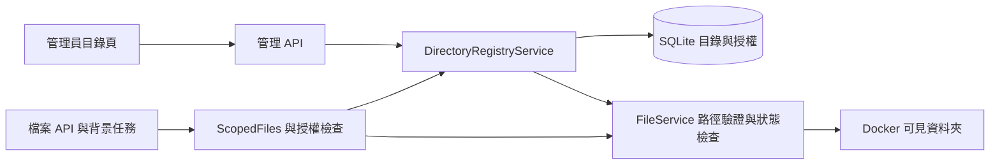

# FileHub 後台目錄登錄與 NFS 子目錄授權調整計畫

- 狀態：A → B → C → D 已實作與驗證；Linux／NFS 實機驗收待部署環境執行。
- 日期：2026-09-16。
- 程式基準：`D:\Codex-Projects\FileHub`，`cea0044`。
- 目標：部署時掛入一次 `/nfs`，日後在管理頁登錄子目錄，再逐帳號設定權限。
- 本文件保留設計與實作驗證結果；基本 Compose 不變，未操作正式 server 或正式資料庫。

## 1. 目標與使用方式

### 1.1 三層分工

| 層級 | 負責的事 | 維護位置 |
| --- | --- | --- |
| Linux / Docker | 讓容器存取得到主機上的資料 | Linux 掛載、Compose |
| 目錄管理 | 選出可以提供給帳號的資料夾，設定名稱與啟用狀態 | FileHub 管理頁、SQLite |
| 帳號管理 | 指定誰可以存取哪些共享目錄，以及各目錄操作權限 | FileHub 管理頁、SQLite |

Docker 掛入父目錄，不會自動把其中所有資料夾授權給一般帳號。

```text
Linux server               容器內                        管理頁登錄名稱
/nfs/reports        →      /files/nfs/reports        →    報表中心
/nfs/departments/it →      /files/nfs/departments/it →    IT 文件
/nfs/finance        →      /files/nfs/finance        →    財務資料
/nfs/private        →      /files/nfs/private        →    未登錄
```

一般帳號 Alice 只獲得「報表中心」及「IT 文件」時，首頁呈現：

```text
所有目錄
├─ 報表中心
└─ IT 文件
```

進入報表後，導覽顯示 `所有目錄 > 報表中心 > 2026`，不提供可點擊的 `nfs` 上層入口。

### 1.2 日常操作

1. 部署者先在 Linux 掛好 NFS，再把 `/nfs` 掛到容器 `/files/nfs`。
2. 管理員到「設定 → 目錄管理 → 新增目錄」。
3. 選取 `nfs/reports`，填寫「報表中心」，儲存。
4. 到帳號管理，替指定帳號加入「報表中心」，選擇唯讀或其他權限。
5. 使用者登入後只會看到自己的授權入口。
6. 以後 `/nfs` 內新增一般子資料夾，可以直接在管理頁登錄，不必逐筆修改 `.env` 或重新啟動容器。

若是增加 `/data` 等另一個主機來源，仍須新增 Docker 掛載。若在 `/nfs` 下新增或重新掛載另一個檔案系統，則需要部署層確認容器可見性，不能當成一般新增資料夾處理。

## 2. 現況與方案選擇

### 2.1 已確認的現況

| 位置 | 現況 | 本次需要調整 |
| --- | --- | --- |
| `compose.yaml` | 預設使用 `files`、`database`、`config` 資料卷 | 維持基本部署；文件提供選用 NFS 掛載片段 |
| `services/directories.py` | 解析 `FILES_DIRECTORIES`，只允許第一層目錄 | 支援既有巢狀資料夾、資料庫登錄與生命週期 |
| `main.py` | 啟動時產生固定目錄清單及 ID/path 對照 | 改為資料庫提供目前有效清單 |
| `models/access.py` | 已有逐帳號的 `DirectoryGrant` 與授權路徑快照 | 沿用授權，不重新發明權限系統 |
| `services/access.py` | 根頁列出實體根下可存取的直接子目錄 | 改為由授權登錄產生虛擬入口 |
| `DirectoriesPage.tsx` | 只能查看部署清單與狀態 | 新增登錄、改名、啟用、停用、影響範圍 |
| `DirectoryGrantEditor.tsx` | 從部署清單選目錄，失效快照提示不足 | 改用登錄清單，明確顯示停用、遺失及路徑不符 |
| 檔案頁、樹狀目錄、目的地選擇器 | 主要以 path 分段建立導覽 | 支援巢狀入口及授權根邊界 |

現有 `ScopedFiles.list_directory()` 仍走實體根目錄列舉。若只放寬目錄設定為 `nfs/reports`，一般帳號沒有 `nfs` 上層權限，入口可能完全不會出現在首頁。因此不能只修改一個路徑驗證條件。

### 2.2 方案比較

| 方案 | 優點 | 代價 | 判斷 |
| --- | --- | --- | --- |
| 放寬環境變數中的路徑 | 修改較少 | 新增目錄仍須改部署設定，管理頁無法維護 | 不符合日常操作需求 |
| 資料庫登錄 + 現有 path API + 授權入口導覽 | 可在後台即時管理，沿用現有檔案操作 | 需要調整清單、授權更新及前端導覽 | 本次採用 |
| 全面改成 directory ID + 目錄內相對路徑 API | 路徑完全隔離，適合未來多種儲存來源 | 需一起遷移分享、任務、垃圾桶、網址及 API | 留待需求擴大時評估 |

維持 React / FastAPI / SQLite 的單體架構與單 worker 執行方式。

## 3. 目錄與授權規則

### 3.1 登錄規則

- 只能登錄 `FILES_ROOT` 內現有且可讀的資料夾，例如 `nfs/departments/it`。
- 後端統一正規化為相對路徑；禁止絕對路徑、`..`、符號連結、junction、受保護或內部暫存路徑。
- 不把 `/files` 總根目錄登錄成共享入口；它仍是管理員的檔案根目錄。
- 登錄只新增資料庫紀錄，不建立、搬移或複製實體資料夾。
- 名稱可修改；ID 與實體路徑建立後固定。更換資料來源要新增目錄並重新授權。
- 名稱只是畫面標籤，不修改 Linux 資料夾名稱。允許相同顯示名稱時，管理頁和選擇器以路徑輔助辨識，內部操作一律使用 ID。
- 維持最多 100 個可管理入口的初始上限；超過前再調整分頁與規模限制。
- 本次提供新增、修改顯示名稱、停用、重新啟用；停用紀錄保留供稽核與重新啟用，先不提供實體刪除或永久刪除登錄功能。

### 3.2 避免父子入口重疊

本次採用容易理解的規則：不同登錄入口不能是彼此的上層或下層，也不能重複指向相同相對路徑。停用紀錄仍保留位置。

- 允許：`nfs/reports` 與 `nfs/finance`。
- 允許：`nfs/departments/it` 與 `nfs/departments/hr`。
- 不允許：同時登錄 `nfs` 與 `nfs/reports`。
- 不允許：同時登錄 `nfs/reports` 與 `nfs/reports/private`。

原因是目前授權會採第一個符合的目錄；放任重疊會讓不同權限的優先順序不明。後端必須按路徑元件比對，不能用單純字串前綴，避免把 `reports-old` 誤判成 `reports` 的子目錄。

若已有整個 `nfs` 的入口，本次不自動拆分。拆分需要獨立遷移方案與帳號影響預覽，避免靜默改變原授權；先完成本次選定子目錄的新部署需求。

不同 bind mount 若實際指向同一資料來源，應用程式不能只靠相對路徑或裝置編號保證辨識；部署文件須要求避免重複暴露同一來源。

### 3.3 權限範圍

- 每個共享入口包含所有後代資料夾；例如授權 `nfs/reports`，也會包含之後建立的 `nfs/reports/2027`。
- 之後新建的同層 `nfs/finance` 不會自動獲得授權。
- 本次不加入共享入口內的排除規則或逐檔案 ACL。若 `reports/private` 不能給同一批人看，需要調整實體目錄分區，或另外設計更細的 ACL。
- 一般帳號的不同入口分別授權；必須有 `browse`，分享仍需 `read + share`。
- 虛擬的「所有目錄」只能導覽，不能上傳、建立、貼上或當成搬移目的地。
- 登錄的入口根及其上層不能被檔案操作改名、搬移或刪除，停用期間也保護；內部檔案依各自權限操作。
- Linux / NFS 權限與 FileHub 權限必須同時允許，操作才會成功。

### 3.4 停用的定義與舊帳號

「停用共享入口」會阻止所有透過這筆多目錄授權的存取，並使相關舊任務／分享失效。重新啟用可恢復保留的帳號授權，但舊任務與分享不能復活。

管理員仍可管理容器可見的檔案。舊式單根目錄帳號也保留原本範圍；例如 root 為 `nfs` 的帳號不會因停用「報表中心」而自動失去 `nfs/reports` 存取權。

因此停用前的影響畫面必須分別顯示：

1. 受此登錄授權影響的多目錄帳號數。
2. 存取範圍與此資料夾重疊的舊式單根目錄帳號。
3. 管理員仍可存取的說明。

新建一般帳號的 UI 預設採多目錄授權。既有單目錄帳號保留；管理員可逐一轉換，儲存前呈現前後範圍，禁止自動擴大權限。需要讓某個人完全無法存取時，必須移除他所有對應範圍或停用該帳號。

## 4. 後端設計

### 4.1 資料模型

新增 `Directory` 登錄模型及資料庫版本 8 遷移；不直接改寫舊版 7 遷移。

| 欄位 | 用途 |
| --- | --- |
| `id` | 穩定識別碼；新資料由後端產生，舊資料沿用 ID |
| `name` | 顯示名稱，沿用 100 字上限 |
| `path` | 正規化後、相對於 `/files` 的位置，建立後固定 |
| `path_key` | 用於重複檢查與唯一限制，遵循執行平台路徑大小寫規則 |
| `enabled` | 管理員設定的啟用狀態 |
| `revision` | 每次編輯增加，防止兩位管理員互相覆寫 |
| `access_revision` | 啟用／停用等授權狀態變更時增加 |
| `created_at` / `updated_at` | 管理與稽核時間 |

另以一筆登錄初始化狀態保存「舊環境變數是否已匯入」，即使初始清單為空也要記錄完成，避免日後重新匯入覆蓋管理頁設定。

沿用 `DirectoryGrant(user_id, directory_id, directory_path, permissions)`。保留快照比對；舊孤立授權不可因新加外鍵被遷移刪除，可由管理頁辨識並移除或重新授權。

`enabled` 是管理設定；`readable / missing / not_directory / unavailable` 是檔案系統檢查結果，兩者不能混成同一狀態。可讀不代表一定可寫，也不代表 NFS 掛載正確。

### 4.2 職責與資料流



- 新增獨立的管理 routes 與 schemas，避免持續把目錄邏輯塞入 `accounts.py`。
- `DirectoryRegistryService` 負責登錄、正規化、重疊檢查、影響查詢、版本與稽核。
- SQLite 是唯一有效來源；不要再把啟動時的 `directory_catalog` 字典當成永久授權依據。
- 查詢與任務檢查取得當次資料庫快照；初版不建立跨請求快取，避免熱更新後看到舊權限。
- 背景任務與分享必須共用同一授權入口，不能各自保留靜態目錄清單。
- 先完成 DB 遷移及目錄初始化，再啟動背景工作執行器。
- NFS 狀態探查不得放在長時間 SQLite 寫入交易內。

### 4.3 API 草案

以下皆位於 `/api/v1`；管理端限定管理員，沿用現有登入與寫入請求防護。

| 方法與路徑 | 行為 |
| --- | --- |
| `GET /admin/directories` | 回傳登錄清單、啟用狀態、檢查結果、版本與授權帳號數 |
| `POST /admin/directories` | 以 name/path 登錄現有目錄，回傳 201 |
| `PATCH /admin/directories/{id}` | 更新 name 或 enabled，要求目前 revision；禁止更改 path |
| `GET /admin/directories/{id}/impact` | 顯示直接授權帳號、重疊的舊式帳號及待失效項目數 |
| `GET /admin/directory-browser?path=...` | 按需列出可選子資料夾，限定 FILES_ROOT |
| `GET /admin/directory-status?path=...` | 沿用現有檢查介面，重新驗證選定資料夾 |
| `GET /directories` | 一般多目錄帳號的有效入口清單，供檔案導覽使用 |

未授權者不能使用管理瀏覽器探查其他目錄。一般入口清單只回傳已授權的 ID、名稱、相對入口及狀態，不回傳 Linux 主機路徑或其他帳號。

- 資料夾瀏覽器每次只列目前一層，最多回傳 200 筆並明示截斷；可直接輸入已知相對路徑再檢查，不遞迴掃描整個 NFS。
- 清單顯示 last checked 時間；手動檢查不寫測試檔，不把 `os.access()` 顯示為寫入保證。
- 重複、父子重疊或版本衝突回 409；路徑格式不合法回 400；權限不足回 403。產品文案須指出具體原因。
- 目錄停用時保留既有授權資料。允許移除失效授權及停用帳號，不要求目錄先恢復可用。
- 新增授權或重新啟用時，必須重新驗證登錄狀態、路徑快照及目錄可用性。

### 4.4 即時撤權與並行修改

1. 目錄變更與檔案最終提交沿用同一 `MUTATION_LOCK` 順序；在鎖內重新檢查 revision，與 DB 更新及稽核一併完成。
2. 啟用狀態改變時增加目錄 `access_revision`。對引用該目錄的一般多目錄帳號增加既有 `AccountAccess.version` 並撤銷 sessions。
3. 目前帳號版本機制會連帶使該帳號在其他目錄的舊任務／分享失效；初版接受這個保守範圍，停用影響畫面必須說明。
4. 任務提交、開始、逐項執行、最終寫入及成品下載重新檢查登錄與授權；分享公開開啟／下載也重新驗證。
5. 只改顯示名稱不撤銷登入，不使原有分享或工作失效。
6. 記錄 `directory.create/update/enable/disable` 稽核事件，details 保存 directory ID 及前後值，不把它塞進原本表示使用者的 target_id。
7. 撤權後停止後續存取與尚未提交的結果；已傳出的下載內容、已完成的檔案操作無法收回。一般串流下載不宣稱可即時截斷已建立的連線。

### 4.5 保留 path API，補足導覽資訊

- 單目錄帳號仍使用相對於自己 root 的 path。
- 多目錄帳號仍使用相對於 FILES_ROOT 的 path，例如 `nfs/reports/2026/a.pdf`。
- 虛擬根清單直接由有效授權產生，不列舉 `/files` 再過濾。
- 清單回傳補充 `directory_id`、`scope_path`、`scope_name`、`parent_path` 及可導覽的 breadcrumbs；前端依後端提供的授權邊界產生路徑。
- 虛擬入口提供獨立的 entry 標記，避免把顯示名稱當成真實資料夾名稱送去改名／刪除；時間欄位沒有值時用空值呈現。
- 入口內第一層的上一層回到「所有目錄」，不能回到未授權的 `nfs` 或 `nfs/departments`。
- 直接輸入 `nfs`、猜未授權路徑、預覽、下載、ZIP、分享及目的地 API 均須由後端拒絕，不能只隱藏按鈕。

## 5. 前端設計

### 5.1 目錄管理頁

沿用 Ant Design Table/Form/Drawer/Modal 與既有緊湊表格風格，不引入其他 UI 套件或更改整體主題。

| 名稱 | 相對目錄 | 啟用狀態 | 存取檢查 | 授權帳號 | 操作 |
| --- | --- | --- | --- | --- | --- |
| 報表中心 | nfs/reports | 已啟用 | 可讀取 | 5 | 編輯／更多 |
| IT 文件 | nfs/departments/it | 已啟用 | 可讀取 | 3 | 編輯／更多 |
| 財務資料 | nfs/finance | 已停用 | 未檢查 | 2 | 編輯／更多 |

- 主要按鈕「新增目錄」；次要按鈕「重新檢查」。
- 新增表單提供顯示名稱、資料夾選擇／相對路徑輸入、檢查結果。
- 儲存成功提示「目錄已登錄，請至帳號管理設定授權」，不自動授權所有人。
- 編輯只改顯示名稱；位置唯讀並說明更換位置需要新入口。
- 停用確認顯示影響範圍；重新啟用確認說明會恢復保留的授權。
- 根目錄狀態與共享登錄分開顯示，避免「所有檔案」被誤認為可授權登錄。
- 清單狀態、失敗、空資料、檢查中、儲存衝突及重試都有明確畫面。

### 5.2 帳號管理

- 新一般帳號預設多目錄模式；管理員角色與既有單目錄帳號維持相容。
- 下拉選擇顯示名稱與相對位置，只允許新增啟用且檢查可用的入口。
- 已有失效授權仍呈現，標示「已停用／目錄遺失／路徑不符／未登錄」，可直接移除。
- 已儲存快照與目前路徑不一致時，同時顯示差異，不把新路徑誤顯示成已授權位置。
- 每一列沿用現有權限範本和勾選，不另外建立重複的權限系統。
- 修正單目錄 root 遺失時無法停用帳號的既有缺口，帳號停用不應依賴 NFS 正常。

### 5.3 檔案頁與操作目的地

- 首頁卡列／清單顯示授權入口名稱；未授權及已停用入口不顯示。
- 啟用但暫時不可用的已授權入口可顯示「目前無法存取」及重試，不能當成空資料夾。
- 左側樹、麵包屑、上一層、複製／搬移／還原目的地共用同一入口與邊界資訊。
- 只在有目的權限的資料夾允許貼上；「所有目錄」不是實體目的地。
- 授權變更後清掉前端目錄快取及失效剪貼簿，提示重新登入／重新選擇。
- 新增同名顯示標籤、深層入口、重新整理網址及窄螢幕驗收。

## 6. 相容與資料遷移

### 6.1 一次性匯入舊設定

1. 版本 8 先建立新表，不刪除舊帳號、授權、任務、分享或垃圾桶。
2. 首次初始化時讀取原本有效的 `FILES_DIRECTORIES`，驗證後在交易內保留原 id/name/path 匯入。
3. 有效宣告可沿用啟用狀態；目錄可用性另行顯示，不能因 NFS 暫時中斷而擴大授權或自動建立資料夾。
4. 即使原清單為空，也記錄「匯入完成」。後續啟動不重複匯入；管理頁更名或停用不會被舊環境變數覆蓋。
5. 若舊環境變數與已初始化資料庫不一致，記錄清楚的棄用／衝突訊息，以資料庫為準。
6. 只有 grant、沒有有效舊目錄宣告時，保留為失效授權，不能僅憑快照自動建立啟用目錄。
7. 同 ID 的舊快照不符時繼續拒絕，不藉此遷移把授權改綁新位置；匯入失敗時交易回滾且不標記完成。

新安裝完全不需要 `FILES_DIRECTORIES`。`.env` 只保留部署層參數；目錄清單、帳號及權限由資料庫管理。

### 6.2 回退

- 升級前以停止服務或 SQLite 一致性備份方式保存 DB、config 及使用中的映像版本，驗證備份可讀。
- 測試升級可重跑、空設定、新安裝、既有多目錄授權、失效授權及中途失敗。
- 若新版本尚未接受使用者檔案修改，可搭配升級前 DB/config 與舊映像回退。
- 若已產生檔案修改／垃圾桶操作，先停止服務並核對 DB 與檔案一致性，不能直接覆蓋舊 DB 或倒回 NFS 內容。
- 不執行 `docker compose down -v`，不把回退等同於刪除資料卷。

## 7. Docker 與 NFS

### 7.1 保留簡單預設，NFS 作為選用設定

保留既有三個 named volumes。需要 NFS 的部署者，在 `filehub.volumes` 增加以下片段即可；先將它寫入 Docker 文件，不另增一組預設啟動檔。

```yaml
      - type: bind
        source: /nfs
        target: /files/nfs
        bind:
          create_host_path: false
```

此片段提供可寫掛載，實際仍受 Linux / NFS 權限限制。若整個來源只供讀取，可在同一項加入 `read_only: true`，並確認 Linux 上子掛載也確實唯讀。

採 long syntax 的 `create_host_path: false`，避免拼錯不存在的來源時自動建立空資料夾。這個選項不能判斷既存 `/nfs` 是否真的已掛上遠端 NFS。語法依據：[Docker Compose volumes](https://docs.docker.com/reference/compose-file/services/#volumes)。

### 7.2 必須分清的狀況

| 變更 | 是否通常需要改 Compose／重建容器 |
| --- | --- |
| 在已掛入的 NFS 檔案系統新增一般資料夾 | 不需要；管理頁登錄並授權即可 |
| 新增另一個主機來源，例如 `/data` | 需要增加掛載 |
| 在 `/nfs` 下新增／替換一個子掛載 | 先確認掛載，再重建容器驗證可見性 |
| Linux 權限、NFS export 或 UID/GID 改變 | 需部署者處理並重新驗證實際操作 |

Docker 的 bind mount 預設使用 `rprivate` 傳播，新增子掛載不能保證自動出現在既有容器內；本次不預設啟用動態掛載傳播。掛載點覆蓋現有容器目錄也會遮住原內容，因此新增 `/files/nfs` 前要確認原位置沒有仍在使用的資料。參考：[Docker bind mounts](https://docs.docker.com/engine/storage/bind-mounts/)。

### 7.3 執行限制

- NFS 由主機先掛載，FileHub 不在網頁掛載 NFS，不接 Docker socket，也不透過 symlink 擴大可見範圍。
- 維持非 root 容器；NFS 的 UID/GID、ACL、root squash 由部署者確認，不自動對 NFS 遞迴改擁有者。
- 目錄遺失或不可用時回報錯誤，不自動補建資料夾，也不將失聯解讀為正常空目錄。
- 同相對路徑被部署者換成另一個來源，不能保證由目錄 ID／路徑快照辨識；更換來源應先停用入口、停止相關存取、確認掛載，再明確恢復。
- NFS I/O 可能長時間等待；前端取消與一般 Python timeout 不等於終止核心層 NFS 呼叫。文件須說明主機掛載與故障處理，不能宣稱簡單狀態檢查可隔離所有 NFS 故障。
- 垃圾桶仍位於 `/files/.files-app-trash`。NFS 常與此處位於不同檔案系統，因此跨檔案系統垃圾桶、還原、搬移保持拒絕；介面顯示限制，不偷偷改成永久刪除。
- 本次不開發每個掛載各自的垃圾桶。瀏覽、下載、授權及可用時的上傳／複製是本次主要目標；完整 NFS 刪除回收另作明確需求。

## 8. 四階段實作與驗收

這是本次改版的新四階段，與先前文件的第三／第四輪不同；先前排除的第五輪正式 Linux 部署不會因此自動重新啟用。

| 階段 | 工作內容 | 進入下一階段的條件 |
| --- | --- | --- |
| A：資料庫登錄與授權基礎 | 新表與一次性匯入、登錄服務、巢狀路徑驗證、停用與版本、動態授權、根目錄保護 | 遷移可重跑；不擴權；停用能阻止新讀寫及失效分享／任務 |
| B：管理頁與帳號設定 | 管理 CRUD 中的新增／更名／啟停、目錄選擇器、影響查詢、失效授權提示、單目錄停用修正 | 不改環境變數即可登錄深層目錄、授權並停用；重啟後設定保留 |
| C：使用者導覽與操作整合 | 虛擬根、顯示名稱、樹／麵包屑／上一層、目的地選擇、快取、分享與批次功能回歸 | 只看到已授權入口；不能越界；複製、ZIP、上傳、分享及撤權行為一致 |
| D：完整回歸與交付文件 | 後端、前端、瀏覽器驗收；Docker/NFS 範例；遷移、回退、管理操作說明 | 自動化驗證通過；文件與實作一致；Linux 未驗證項目明列 |

每階段完成記錄實際測試結果，未過的階段不宣稱完成。A～C 的中間版本只供開發驗證；完整驗收前不當成對外可用版本發布。

D 提供 Linux Docker／NFS 的人工驗收步驟。實際 server 部署與真實 NFS 測試，在可用的 Linux 測試環境另行執行；不把本機測試當成部署完成。

## 9. 修改範圍與驗證

### 9.1 預計修改的主要檔案

| 檔案／模組 | 工作 |
| --- | --- |
| `backend/app/models/directory.py`（新增） | 目錄登錄與初始化狀態 |
| `backend/app/db/migrations.py`、`db/session.py` | 版本 8 與啟動初始化流程 |
| `backend/app/services/directories.py` | 登錄服務、檢查與舊設定匯入 |
| `backend/app/api/routes/directories.py`、`schemas/directories.py`（新增） | 管理、瀏覽、影響及使用者入口 API |
| `backend/app/main.py`、`core/config.py` | router 註冊、啟動順序與舊設定棄用 |
| `backend/app/api/routes/accounts.py`、`models/access.py` | 帳號驗證、失效授權與版本整合 |
| `backend/app/services/access.py`、`files.py`、`schemas/files.py` | 動態授權、虛擬根與根目錄保護 |
| `services/operations.py`、`folder_uploads.py`、`archives.py`、`trash.py`、`api/routes/shares.py` | 檢查入口變更的影響，修正必要呼叫點與回歸案例 |
| `frontend/src/features/auth/DirectoriesPage.tsx` | 管理介面 |
| `frontend/src/features/auth/DirectoryGrantEditor.tsx`、`AccountsPage.tsx` | 帳號授權與相容提示 |
| `frontend/src/features/files/FilesPage.tsx`、`DirectoryTree.tsx`、`OperationPanel.tsx` | 導覽與目的地邊界 |
| `frontend/src/lib/api.ts`、必要的共用目錄導覽模組 | API schema 與共用導覽資訊 |
| `backend/tests/`、`frontend/tests/` | 遷移、授權、撤權與使用者流程測試 |
| `docs/DOCKER.md`、`DIRECTORY_MANAGEMENT.md`、`MIGRATION.md`、`PROJECT_STRUCTURE.md`、必要 README 連結 | 對齊實際新版使用方式 |

只因新功能需要才修改上述呼叫點；不趁此全面拆分 FilesPage 或更動品牌、安裝入口、空目錄與歷史紀錄。

### 9.2 必測情境

1. 新 DB、舊版本 7 DB、舊環境變數匯入、空匯入、重啟及匯入失敗回滾。
2. `nfs/reports` 和更深目錄成功；絕對路徑、穿越、連結、重複、父子重疊被拒絕。
3. 登錄不自動授權；新增同層目錄不會出現在未授權帳號首頁。
4. 授權入口內新建子資料夾可用，上一層止於授權入口，直接 API 越界被拒絕。
5. 顯示名稱更改不移動實體檔案、不撤銷登入；目錄位置不可原地改綁。
6. 停用、重新啟用、登入撤銷、舊分享 Cookie、ZIP 成品、排隊任務、執行中提交與上傳重送。
7. 來源唯讀、目的可寫的跨目錄複製；不允許把某一入口的權限拿到另一入口使用。
8. 目錄遺失時仍可停用帳號／移除授權，重新啟用時重新驗證。
9. 舊單目錄與管理員權限維持原義，影響預覽不漏掉重疊的舊式帳號。
10. 兩個管理員同時建立重疊入口、同時編輯同一筆資料或同時授權／停用時，交易與版本處理正確。
11. 登錄根及祖先的改名／搬移／垃圾桶操作被拒絕；一般內部檔案仍按權限操作。
12. 同名顯示標籤、空清單、暫時不可用、超過瀏覽數量上限、1440/768/390 px、鍵盤操作及無 pageerror。
13. Linux 可用時測試：掛載缺失、唯讀、UID/GID 權限、不同檔案系統、子掛載建立順序、NFS 故障恢復及容器重建。

### 9.3 規劃中的驗證命令

以下為一般驗證命令；本次實際結果及瀏覽器分批方式見文末：

```text
python -m pytest backend/tests
python -m ruff check backend
npm --prefix frontend run build
npm --prefix frontend run format:check
npm --prefix frontend run test:e2e
```

Linux Docker 測試時另執行 `docker compose config`，檢查實際 mount，再以隔離測試資料驗證行為。先核對現有 Ruff 基線與瀏覽器測試環境，區分原有問題與本次回歸。

## 10. 參考與限制

- 現有實作與已完成歷史輪次：[目錄管理](DIRECTORY_MANAGEMENT.md)、[多目錄實作紀錄](MULTI_DIRECTORY_PLAN.md)。
- Docker 官方：[Bind mounts](https://docs.docker.com/engine/storage/bind-mounts/)、[Compose volumes](https://docs.docker.com/reference/compose-file/services/#volumes)，查閱日期 2026-09-16。
- 本規劃直接核對 D 槽目前來源碼。SymbolLattice 0.467.0 的現有索引回報 `FRESH_INDEX_REQUIRED`，此次以原始碼為準，未重建索引。
- 本次已執行隔離功能測試與版本 8 遷移測試；未執行 Linux Docker／NFS 驗收、正式資料遷移、commit 或 push。


## 實作進度

- A：目錄登錄模型、版本 8、一次性匯入、管理 API、動態授權與停用撤權已完成；相關後端 52 項通過。
- B：管理表單、選擇器、影響提示、帳號失效授權標示已完成；TypeScript/Vite 與 7 個相關瀏覽器案例通過，檢視桌面與手機截圖。
- C：虛擬根與導覽整合已完成；43 項相關後端與 7 個相關瀏覽器案例通過（含前階段回歸）。
- D：完整回歸、停用中途撤權案例、目錄／Docker／遷移／架構文件已完成。


## 最終驗證（2026-09-16）

- 後端完整回歸 146 項通過；其後補上一個停用中途撤權案例，目錄登錄檔 25 項全部通過（其中 24 項與完整回歸重複），合計覆蓋 147 個案例。
- 停用案例確認執行中及排隊中的複製任務不提交目的檔案，已完成 ZIP 的舊下載權失效。
- 瀏覽器 40 項分成 36 + 4 兩批通過。一次跑完曾遇到共用空資料夾被前案寫入，以及五分鐘內共用來源超過 10 次登入的既有節流限制。空資料夾案例已改用獨立 fixture；登入限制未調弱。
- TypeScript 檢查與 Vite 正式建置通過；保留既有大於 500 kB 的 bundle 提示。
- 本次修改 Python 檔案 Ruff、前端檔案 Prettier、git diff --check 通過。全後端 Ruff 的三個 I001 位於未修改的 test_accounts.py、test_frontend_routes.py，已對照 HEAD 確認原本存在。全前端 format:check 仍會報出未修改檔案的格式問題，未擴大整理。
- 已檢查 1440、768、390 px 的目錄管理、登錄表單與深層入口測試；實際檢視桌面／手機截圖。
- 測試資料庫與檔案均隔離；未更動正式帳號資料或掛載來源。本機沒有 Docker，不能以這些結果代替 Linux NFS／UID／ACL／跨裝置操作驗收。

重跑瀏覽器全套時，在 frontend 目錄分兩次啟動隔離 server：

```bash
npx playwright test --grep-invert 'browse, special filenames|mobile layout and empty directory|wrong login and password change|late directory response'
npx playwright test tests/workspace.spec.ts
```

文件入口：[目錄管理](DIRECTORY_MANAGEMENT.md)、[Docker 掛載](DOCKER.md)、[版本 8 遷移](MIGRATION.md)。
