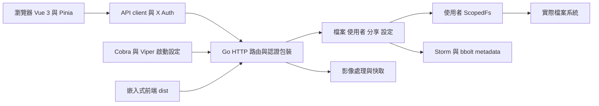

# File Browser 研究範圍與架構總覽

這組報告的目的，是把 File Browser 拆成可供 FileHub 改寫使用的產品行為、視覺規格與實作契約。主要可借鑑的是路徑導向的檔案工作空間、依權限與選取狀態改變的操作，以及後端對使用者檔案範圍的集中處理；登入連線、刪除政策、批次工作和上傳生命週期需要重新設計。

## 1. 來源身分

| 項目 | 已核對的內容 |
| --- | --- |
| 本機來源 | `C:\Users\win10\Desktop\Github\filebrowser` |
| Git origin | `https://github.com/filebrowser/filebrowser.git` |
| 分支與 commit | `master`，`833d908884d5c801f30f5c098d7977177eb3a36b` |
| 最近提交 | `docs: update post link` |
| Git describe | `v2.63.23-2-g833d9088`，表示距該 tag 兩個提交，不代表有同名正式版本 |
| 追蹤檔案 | 417 個；其中 `frontend/` 200 個、`http/` 36 個、`cmd/` 28 個 |
| 來源狀態 | 分析前與分析後，`git status --porcelain --untracked-files=all` 均為空 |
| 研究日期 | 2026-10-27，Asia/Taipei |

不要把 `frontend/package.json` 的 `3.0.0` 當成後端 release 版本。來源的 `version.Version` 與 `version.CommitSHA` 預設為未追蹤／未知字串，正式建置由 linker 注入。本次隔離建置注入 `study-833d9088` 與完整 commit，避免假裝是官方發行檔。[package.json](https://github.com/filebrowser/filebrowser/blob/833d908884d5c801f30f5c098d7977177eb3a36b/frontend/package.json#L1-L12)、[version.go](https://github.com/filebrowser/filebrowser/blob/833d908884d5c801f30f5c098d7977177eb3a36b/version/version.go#L1-L9)、[Taskfile.yml](https://github.com/filebrowser/filebrowser/blob/833d908884d5c801f30f5c098d7977177eb3a36b/Taskfile.yml#L12-L23)。

## 2. 三種證據與結論強度

| 標示 | 可以支持的結論 | 不能直接支持的結論 |
| --- | --- | --- |
| 來源確認 | 指定 commit 定義的 CSS、函式、路由、資料結構、分支與測試情境 | 實際環境必然走到該分支、測試已通過、效能達標 |
| 隔離實測 | 本次指定來源建置，在暫存資料與測試帳號下實際呈現或發出的請求 | 官方二進位完全相同、所有使用者權限／瀏覽器／檔案格式皆可用 |
| FileHub 建議 | 根據分析提出的新元件、API、資料模型、開發順序與驗收標準 | 已實作、已選定所有技術、可以直接部署 |

完整來源分析使用一般檔案工具；REA 用於本次獨立 Chrome 的被動 DOM、可及性、請求與畫面觀察。Playwright 負責導覽與操作，REA 不負責點擊或執行頁面 JavaScript。詳見[執行證據](06-runtime-evidence.md)。

## 3. 技術組成與責任

| 子系統 | 主要來源 | 作用與對 FileHub 的價值 |
| --- | --- | --- |
| SPA 啟動 | `frontend/src/main.ts`、`router/index.ts` | Vue plugins、i18n、路由守衛與深連結 |
| 應用程式殼層 | `views/Layout.vue`、`components/Sidebar.vue` | 共用導覽、全域提示、上傳面板；側欄是功能導覽，並非目錄樹 |
| 工作空間 | `views/Files.vue`、`views/files/FileListing.vue` | 依資源型別分流列表、編輯器、預覽器 |
| 共用狀態 | `stores/auth.ts`、`file.ts`、`layout.ts`、`upload.ts`、`clipboard.ts` | 登入、資源與選取、覆層、上傳佇列、檔案剪貼簿 |
| 服務組裝 | `cmd/root.go`、`http/http.go` | 設定、資料庫、快取、listener、路由與靜態資產 |
| 檔案領域 | `files/`、`fileutils/`、`rules/`、`search/` | metadata、scope、權限規則、複製搬移及遞迴搜尋 |
| 持久資料 | `storage/bolt/`、`users/`、`share/`、`settings/` | 使用者、分享、認證設定及產品設定；檔案內容仍在檔案系統 |
| 上傳與衍生內容 | `http/tus_handlers.go`、`http/cache/`、`img/`、`diskcache/` | TUS tracking、縮圖與快取；不可與持久檔案混為一談 |

上述結構的來源定位及實際 API 請見 [03 後端報告](03-backend-and-api.md)與 [04 流程報告](04-user-flows-and-state.md)。前端依賴明確為 Vue 3、Pinia、Vue Router、Vite、Ace、TUS client 等，後端 `go.mod` 宣告 Go 1.25.0；FileHub 不需要因為參考此專案而沿用相同技術。[frontend/package.json](https://github.com/filebrowser/filebrowser/blob/833d908884d5c801f30f5c098d7977177eb3a36b/frontend/package.json)、[go.mod](https://github.com/filebrowser/filebrowser/blob/833d908884d5c801f30f5c098d7977177eb3a36b/go.mod#L1-L40)。

## 4. 問題清單與覆蓋程度

| 原始研究問題 | 目前覆蓋 | 對應報告 |
| --- | --- | --- |
| 網頁配色、字體、尺寸、版面、斷點是什麼 | 來源規格完整整理，另有桌面／平板／手機截圖 | 02、06 |
| 頁面與元件如何分工 | 來源確認，核心頁面實際開啟 | 02、04、06 |
| 從點擊到檔案修改如何完成 | 核心流程來源追蹤；新增、TUS 上傳、重新命名與刪除實測 | 03、04、06 |
| API、資料儲存與權限如何串接 | 來源確認；非完整整合／安全測試 | 03、05 |
| 哪些做法應避免直接搬入 FileHub | 逐項區分來源限制與改寫建議 | 05、07 |
| 如何分階段改寫與驗收 | 已提出可執行的開發切片，尚未實作 | 07 |
| 大型資料夾、NFS、斷線續傳、多人同時操作是否可靠 | 尚未做環境或壓力驗證，不能從小量實測推論 | 06、07 |

## 5. 使用報告的方式

先以 [02](02-ui-style-and-layout.md)建立畫面與控制項清單，再以 [04](04-user-flows-and-state.md)建立每個操作的狀態與錯誤分支；實作 API 前對照 [03](03-backend-and-api.md)及 [05](05-security-and-rewrite-boundaries.md)。[06](06-runtime-evidence.md)回答哪些行為真的跑過，[07](07-filehub-rewrite-blueprint.md)則將來源拆成 FileHub 的開發順序。

這不是逐行移植計畫。以可觀察的行為、明確的 API 契約及驗收案例為共同基準，再用 FileHub 的設計系統重新實作。
