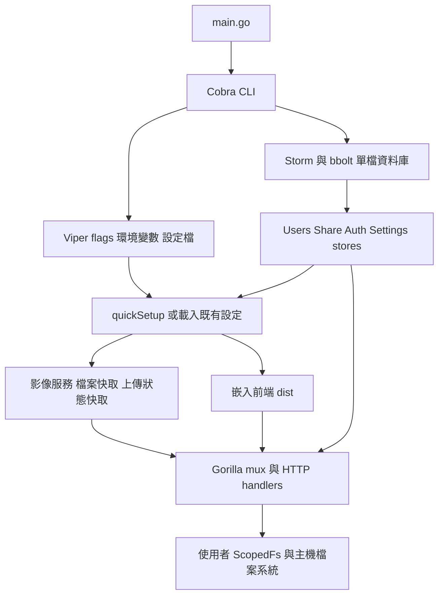
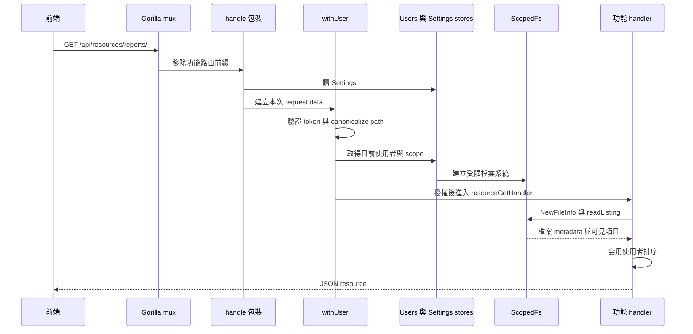
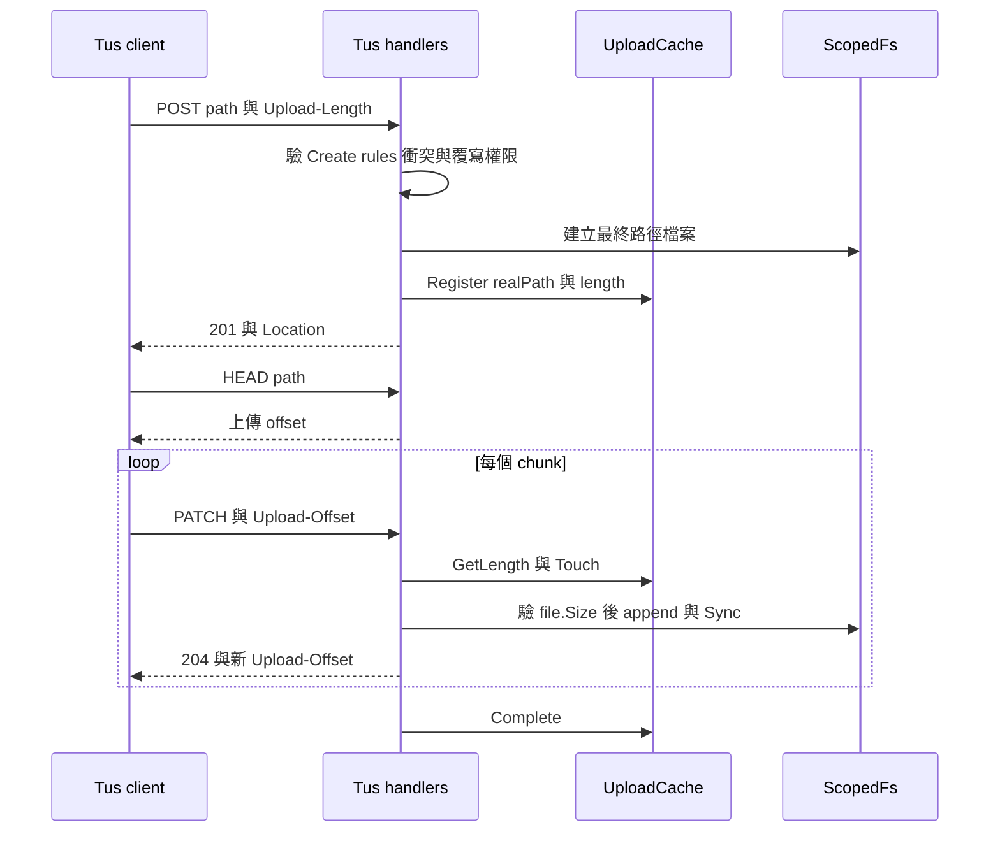

# File Browser 後端架構與 API 實作報告

本報告說明 File Browser 如何將登入、使用者目錄範圍、檔案操作、分享與前端資產整合成單一 Go 服務，供 FileHub 重寫時制定後端契約。最值得保留的是「每次請求先建立使用者檔案系統範圍，再執行操作」及清楚分離 metadata、原始內容與縮圖的做法；資料庫、上傳生命週期與長時間工作則應按 FileHub 需求重新設計。

- 分析來源：`C:\Users\win10\Desktop\Github\filebrowser`。
- 固定版本：`833d908884d5c801f30f5c098d7977177eb3a36b`。
- 證據類型：以下「原專案實作」為原始碼已驗證；沒有宣稱已對此 commit 執行後端整合測試或效能量測。
- 「FileHub 建議」是重寫設計選項，尚未實作，也不構成選定 Go、BoltDB 或其他後端技術。

## 1. 原專案實作：從 CLI 到 HTTP 的架構

`main()` 僅呼叫 `cmd.Execute()`；真正組裝在 `rootCmd.RunE`。它在首次建立資料庫時呼叫 `quickSetup`，建立影像服務及兩種用途不同的快取，讀取 server 設定，選擇 TCP、TLS 或 Unix socket listener，再將 embedded frontend 與 stores 注入 `fbhttp.NewHandler()`。HTTP server 設定 `ReadHeaderTimeout=60s`；收到指定停止訊號後用 10 秒期限進行 `Shutdown`。[來源：main.go:9–12](https://github.com/filebrowser/filebrowser/blob/833d908884d5c801f30f5c098d7977177eb3a36b/main.go#L9-L12)、[cmd/root.go:159–285](https://github.com/filebrowser/filebrowser/blob/833d908884d5c801f30f5c098d7977177eb3a36b/cmd/root.go#L159-L285)。

| 原始碼位置 | 責任 | 對重寫的意義 |
| --- | --- | --- |
| `cmd/` | CLI、環境變數、設定匯入匯出、bootstrap、服務組裝 | 把維運操作與 request handlers 分開 |
| `http/` | 路由、認證包裝、request parsing、response、功能入口 | 可對照新 API controller 邊界 |
| `files/` | 檔案 metadata、列表、排序、MIME、ScopedFs | 是檔案領域核心，不宜散落在 UI 或各 API |
| `fileutils/` | 遞迴複製、搬移與共通路徑操作 | 長時間副作用需另行設計工作模型 |
| `users/`、`share/`、`settings/`、`auth/` | domain structs、storage contracts 與一致性處理 | domain 與具體資料庫存取分離 |
| `storage/bolt/` | Storm/bbolt 的具體持久化實作 | 可換成 FileHub 決定的資料庫 adapter |
| `img/`、`diskcache/` | 影像處理、磁碟快取 | 避免把衍生預覽視為原始檔本體 |
| `search/`、`rules/` | 遞迴名稱搜尋、路徑規則 | 搜尋及授權必須使用相同虛擬路徑語意 |

`storage.Storage` 組合 `Users`、`Share`、`Auth`、`Settings` 四個 store，`bolt.NewStorage()` 負責注入 adapter，並保存資料庫格式版本 `2`。這個 `2` 是 storage metadata，不是產品 SemVer。[來源：storage/storage.go:10–17](https://github.com/filebrowser/filebrowser/blob/833d908884d5c801f30f5c098d7977177eb3a36b/storage/storage.go#L10-L17)、[storage/bolt/bolt.go:13–30](https://github.com/filebrowser/filebrowser/blob/833d908884d5c801f30f5c098d7977177eb3a36b/storage/bolt/bolt.go#L13-L30)。

## 2. 原專案實作：設定、啟動與前後端連接

### 2.1 設定來源有兩個層次

CLI 說明的優先序是 flags → `FB_*` 環境變數 → 設定檔 → 資料庫 → 預設值。Viper 搜尋目前目錄、使用者家目錄及 `/etc/filebrowser/` 中的 `.filebrowser` 設定；但不是所有產品設定都能放在設定檔。`Server` 保存 host、port、root、TLS、BaseURL 等執行設定；`Settings` 保存 signup、使用者預設、branding、Tus、規則與檔案 mode 等產品設定。`getServerSettings()` 先讀資料庫，再覆蓋有提供的外部值。[來源：cmd/root.go:130–154](https://github.com/filebrowser/filebrowser/blob/833d908884d5c801f30f5c098d7977177eb3a36b/cmd/root.go#L130-L154)、[cmd/utils.go:85–128](https://github.com/filebrowser/filebrowser/blob/833d908884d5c801f30f5c098d7977177eb3a36b/cmd/utils.go#L85-L128)、[cmd/root.go:289–374](https://github.com/filebrowser/filebrowser/blob/833d908884d5c801f30f5c098d7977177eb3a36b/cmd/root.go#L289-L374)。

| 設定 | CLI 中的預設 | 作用 |
| --- | --- | --- |
| `database` | `./filebrowser.db` | metadata 資料庫位置 |
| `address`、`port` | `127.0.0.1`、`8080` | 直接執行的 listen address；Docker 預設另有設定 |
| `root` | `.` | 所有使用者 scope 的主機基底目錄 |
| `baseURL` | 空字串 | 子路徑部署前綴 |
| `tokenExpirationTime` | `2h` | 登入 token 的設定期限 |
| `imageProcessors` | `4` | 影像處理同時執行數量 |
| `cacheDir` | 空字串 | 空字串使用 NoOp 檔案快取 |
| `redisCacheUrl` | 空字串 | 空字串使用記憶體上傳狀態快取 |
| `disableExec` | `true` | 關閉 Command Runner |
| `followExternalSymlinks` | `false` | 預設拒絕指向 scope 外部的 symlink |

[來源：cmd/root.go:81–115](https://github.com/filebrowser/filebrowser/blob/833d908884d5c801f30f5c098d7977177eb3a36b/cmd/root.go#L81-L115)。這些是 CLI 宣告值，不能直接當成既有部署的有效設定。

### 2.2 前端 build 是後端執行必要輸入

`frontend/assets.go` 使用 `//go:embed dist/*`。啟動時取 `dist` 子目錄交給 HTTP layer。`getStaticHandlers()` 將未匹配的 GET 路徑交給 `public/index.html`，支援 SPA history routes；`/static/` 對應靜態資產，JavaScript 從 `.js.gz` 讀取，依 `Accept-Encoding` 決定直接回 gzip 或解壓回傳。靜態資產設一天的 public cache；原始檔與縮圖則使用 private cache。[來源：frontend/assets.go:1–12](https://github.com/filebrowser/filebrowser/blob/833d908884d5c801f30f5c098d7977177eb3a36b/frontend/assets.go#L1-L12)、[http/static.go:106–180](https://github.com/filebrowser/filebrowser/blob/833d908884d5c801f30f5c098d7977177eb3a36b/http/static.go#L106-L180)。

HTML 不是完全固定的靜態檔：`handleWithStaticData()` 注入 branding、BaseURL、版本、認證模式、signup、縮圖及 Tus 設定等 JSON。前端據此呈現功能。自訂 branding CSS 的入口是指定 branding 目錄中的 `custom.css`。[來源：http/static.go:24–98](https://github.com/filebrowser/filebrowser/blob/833d908884d5c801f30f5c098d7977177eb3a36b/http/static.go#L24-L98)。

**FileHub 建議：** 重寫可保留「單一後端提供正式版 SPA」的部署便利性，但將執行期公開設定明確定義成有限的 bootstrap DTO 或 endpoint，避免公開 private settings。前端工具鏈不必沿用 Vue。設定介面與 API 權限仍須由 server 強制執行，不能把 HTML feature flags 當授權。

## 3. 原專案實作：一次 API 請求的完整路徑

共同 `handle()` 會加 response headers、從 store 取得 settings、建立 request `data`，並處理 `(status, error)` 的結果。`withUser()` 驗 JWT 後不是只相信 token 裡的權限，而是以 user ID 重新取得使用者，再 canonicalize request path；`withAdmin()` 再檢查 `Perm.Admin`。每個功能 handler 還需檢查對應 permission。[來源：http/data.go:87–121](https://github.com/filebrowser/filebrowser/blob/833d908884d5c801f30f5c098d7977177eb3a36b/http/data.go#L87-L121)、[http/auth.go:116–153](https://github.com/filebrowser/filebrowser/blob/833d908884d5c801f30f5c098d7977177eb3a36b/http/auth.go#L116-L153)。

這不是一個全面套在所有 `/api` 路由上的 auth middleware：認證是以 `withUser`、`withAdmin`、分享 wrapper 等函式組合在各 handlers 上。因此新增 API 時若漏包裝，就有漏做授權的可能。公開分享和 login 等入口也因此有自己的處理路徑。

`handle()` 遇錯回傳的是 HTTP status text，400 可附 error 字串；`errToStatus()` 將 permission、not found、exists、invalid params、image too large 對應到 403、404、409、400、413。JSON response 則由 `renderJSON()` 統一 marshal。原專案沒有在這一層採用固定 `{code, message, requestId}` 的 JSON error envelope。[來源：http/data.go:106–118](https://github.com/filebrowser/filebrowser/blob/833d908884d5c801f30f5c098d7977177eb3a36b/http/data.go#L106-L118)、[http/utils.go:59–97](https://github.com/filebrowser/filebrowser/blob/833d908884d5c801f30f5c098d7977177eb3a36b/http/utils.go#L59-L97)。

## 4. 原專案實作：核心 API 契約

下列 `{path}` 表示 suffix path，套用 `baseURL` 前綴前的路徑。路由選擇與 method 以 `http/http.go` 為準；相同行為可能再受使用者 permission、rules、scope、下載權限及 feature flags 影響。

| Method | 路徑 | 主要行為與契約 |
| --- | --- | --- |
| 前端使用 POST；路由未限定 | `/api/login` | 認證並回傳 token；認證 provider 解讀 request，不應推論 router 限定 POST |
| 前端使用 POST；路由未限定 | `/api/signup` | signup 開啟時解讀 JSON body 並建立帳號 |
| 前端使用 POST；路由未限定 | `/api/renew` | 以既有身分更新 token；所讀 handler 沒有 method guard |
| GET | `/api/users` | 管理員列出使用者 |
| POST | `/api/users` | 管理員建立使用者 |
| GET、PUT、DELETE | `/api/users/{id}` | 自己或管理員可操作；各 operation 有額外保護 |
| GET | `/api/resources/{path}` | 資料夾回完整目前層列表；檔案回 metadata，特定文字編碼路徑可回 raw bytes |
| GET | `/api/resources/recursive/{path}` | server 遞迴展平成 `{path,name,size,modified,isDir}[]` |
| POST | `/api/resources/{path}` | 尾斜線建立資料夾；其他 path 以 body bytes 新增檔案，`override=true` 才覆寫 |
| PUT | `/api/resources/{path}` | 修改既有檔案內容；資料夾回 405，不存在回 404 |
| PATCH | `/api/resources/{path}` | `action=copy` 或 `rename`，以 `destination`、`override`、`rename` 控制目的地與衝突策略 |
| DELETE | `/api/resources/{path}` | 檢查刪除權限與 descendant rules，直接刪除，並處理分享與縮圖 |
| POST | `/api/tus/{path}` | 用 `Upload-Length` 建立分塊上傳，回 201 與 `Location` |
| HEAD、GET | `/api/tus/{path}` | 取得上傳 offset 等狀態 |
| PATCH | `/api/tus/{path}` | `application/offset+octet-stream`，用 `Upload-Offset` 接續寫入 |
| DELETE | `/api/tus/{path}` | 刪除進行中的上傳檔案並清除 tracking |
| GET | `/api/raw/{path}` | 原始檔下載；目錄或多選以串流產生 archive |
| GET | `/api/preview/{size}/{path}` | 圖片 `thumb`／`big`；不支援的檔案型別回 501 |
| GET | `/api/search/{path}?query=…` | 從該 scope 遞迴搜尋，逐行輸出 JSON 結果 |
| GET | `/api/usage/{path}` | 查所在檔案系統的 total／used，並非遞迴計算資料夾大小 |
| GET | `/api/shares` | 取得可管理分享列表 |
| GET、POST、DELETE | `/api/share/{suffix}` | 查詢、建立與撤銷分享；suffix 的解讀依 handler 而異 |
| GET | `/api/public/share/{suffix}` | 公開分享 metadata／列表 |
| GET | `/api/public/dl/{suffix}` | 公開分享下載；另行驗分享密碼與期限 |
| GET、PUT | `/api/settings` | 管理員讀寫產品設定 |
| GET | `/api/subtitle/{path}` | 字幕內容入口 |
| GET | `/api/command/{path}` | Command Runner；屬重寫時應排除或另案處理的能力 |
| 未限定 method | `/health` | 直接回 200，非資料庫、外部掛載或寫入能力 readiness |

[路由總表：http/http.go:45–96](https://github.com/filebrowser/filebrowser/blob/833d908884d5c801f30f5c098d7977177eb3a36b/http/http.go#L45-L96)、[登入及 renew handlers：http/auth.go:156–249](https://github.com/filebrowser/filebrowser/blob/833d908884d5c801f30f5c098d7977177eb3a36b/http/auth.go#L156-L249)、[前端認證呼叫：frontend/src/utils/auth.ts:51–110](https://github.com/filebrowser/filebrowser/blob/833d908884d5c801f30f5c098d7977177eb3a36b/frontend/src/utils/auth.ts#L51-L110)、[使用者授權：http/users.go:57–73](https://github.com/filebrowser/filebrowser/blob/833d908884d5c801f30f5c098d7977177eb3a36b/http/users.go#L57-L73)、[health：http/public.go:167](https://github.com/filebrowser/filebrowser/blob/833d908884d5c801f30f5c098d7977177eb3a36b/http/public.go#L167)。

### 4.1 Metadata 資料形狀

`FileInfo` 的可序列化欄位包含 `path`、`name`、`size`、`extension`、`modified`、`mode`、`isDir`、`isSymlink`、`type`，以及選填 `subtitles`、`content`、`checksums`、`token`、`resolution`；資料夾以 `Listing` 提供 `items`、`numDirs`、`numFiles`、`sorting`。`Fs` 與目前目錄的原始 FileInfo 列表不進 JSON。[來源：files/file.go:36–71](https://github.com/filebrowser/filebrowser/blob/833d908884d5c801f30f5c098d7977177eb3a36b/files/file.go#L36-L71)、[files/listing.go:10–16](https://github.com/filebrowser/filebrowser/blob/833d908884d5c801f30f5c098d7977177eb3a36b/files/listing.go#L10-L16)。

`GET /resources` 同時承擔 metadata 與文字內容，且 `X-Encoding: true` 可能切換成 `application/octet-stream`。前端 `files.fetch()` 也依 Content-Type 分支。這是閱讀原碼及重寫 API adapter 時不可忽略的隱性契約。[來源：http/resource.go:25–85](https://github.com/filebrowser/filebrowser/blob/833d908884d5c801f30f5c098d7977177eb3a36b/http/resource.go#L25-L85)、[frontend/src/api/files.ts:8–49](https://github.com/filebrowser/filebrowser/blob/833d908884d5c801f30f5c098d7977177eb3a36b/frontend/src/api/files.ts#L8-L49)。

**FileHub 建議：** metadata、text content、binary download 使用明確不同的端點或 response contract。新的列表契約應預先容納 pagination／cursor、排序及部分結果說明，而不是從 UI 假設所有 entries 永遠一次回傳。

## 5. 原專案實作：資料庫與檔案本體的分工

Storm 透過 bbolt 開啟單一 metadata DB，檔案 mode 是 `0640`。`config` bucket 保存 `settings`、`server` 等值；User 與 Share 透過 Storm struct/index 存取。原始檔案仍保存在主機檔案系統，不是存入 BoltDB 的 blob。[來源：cmd/utils.go:150–189](https://github.com/filebrowser/filebrowser/blob/833d908884d5c801f30f5c098d7977177eb3a36b/cmd/utils.go#L150-L189)、[storage/bolt/utils.go:11–21](https://github.com/filebrowser/filebrowser/blob/833d908884d5c801f30f5c098d7977177eb3a36b/storage/bolt/utils.go#L11-L21)。

| 結構 | 重要欄位／索引 | 重寫應理解的意義 |
| --- | --- | --- |
| `users.User` | 自增 `ID`、unique `Username`、`Password`、`Scope`、`Perm`、`Rules` | identity、授權、偏好混合在同一模型 |
| 使用者偏好 | `Locale`、`ViewMode`、`SingleClick`、`Sorting`、`HideDotfiles`、`DateFormat`、`AceEditorTheme` | 可帶到新前端，但應與敏感欄位分開回傳 |
| `share.Link` | `Hash` 是 id/index，`Path` index，另有 `UserID`、`Expire`、`PasswordHash` | 分享指向虛擬路徑與擁有人，不是獨立存檔副本 |
| `settings.Settings` | signup、defaults、branding、rules、Tus、file／dir mode | 產品設定 |
| `settings.Server` | root、baseURL、listen、TLS、feature flags | 執行環境設定；`CaseInsensitiveFs` 不持久化 |

[來源：users/users.go:21–38](https://github.com/filebrowser/filebrowser/blob/833d908884d5c801f30f5c098d7977177eb3a36b/users/users.go#L21-L38)、[share/share.go:10–19](https://github.com/filebrowser/filebrowser/blob/833d908884d5c801f30f5c098d7977177eb3a36b/share/share.go#L10-L19)、[settings/settings.go:23–70](https://github.com/filebrowser/filebrowser/blob/833d908884d5c801f30f5c098d7977177eb3a36b/settings/settings.go#L23-L70)。

**FileHub 建議：** 即使採用 SQLite，也應保留 domain store 與檔案儲存層的分工。不要把單一 DB transaction 誤認成「DB 加檔案操作」的跨資源原子性。刪除分享紀錄、搬移檔案、更新快取若中途失敗，需要可重試步驟及操作紀錄，而非假設整段會一起 rollback。

## 6. 原專案實作：scope、rules 與檔案操作

### 6.1 路徑有三種不同含義

1. URL 中的虛擬路徑，例如 `/reports/a.pdf`。
2. 使用者 `Scope`，相對於 server root 的個人可見根目錄。
3. 實際主機路徑，由 `server.Root + user.Scope + virtualPath` 在受控層解析。

`User.Clean()` 由 root 及 scope 建立 `files.NewFs()`。預設為 `ScopedFs`，它包住 Afero `BasePathFs` 的 lexical confinement，再於開啟、stat、建立、刪除、改名等操作前檢查實際 symlink target 是否仍在 scope 中。選擇 `followExternalSymlinks=true` 則退回一般 `BasePathFs`。[來源：users/users.go:58–103](https://github.com/filebrowser/filebrowser/blob/833d908884d5c801f30f5c098d7977177eb3a36b/users/users.go#L58-L103)、[files/scoped.go:14–47、73–156](https://github.com/filebrowser/filebrowser/blob/833d908884d5c801f30f5c098d7977177eb3a36b/files/scoped.go#L14-L156)。

`slashClean()` 和 `canonicalizeRequestPath()` 處理不同主機的分隔符號、`.`／`..`，並保留建立目錄所需的尾斜線。規則檢查和實際檔案操作若使用不同正規化方式，可能對同一 URL 解讀成不同檔案；這層必須統一。[來源：http/utils.go:17–56](https://github.com/filebrowser/filebrowser/blob/833d908884d5c801f30f5c098d7977177eb3a36b/http/utils.go#L17-L56)。

`data.CheckRules()` 依序套用全域規則，再套用使用者規則，匹配時覆寫 allow 值；`Check()` 另處理 dotfiles 顯示偏好。對 copy、rename、delete，`checkDescendants()` 還檢查整個來源樹及對應目的樹，避免只通過父目錄而繞過子項目規則。[來源：http/data.go:36–84](https://github.com/filebrowser/filebrowser/blob/833d908884d5c801f30f5c098d7977177eb3a36b/http/data.go#L36-L84)、[http/resource.go:278–311](https://github.com/filebrowser/filebrowser/blob/833d908884d5c801f30f5c098d7977177eb3a36b/http/resource.go#L278-L311)。

這些是防護機制的靜態觀察，不是對競態條件隔離或所有 OS 邊界的安全證明。

### 6.2 目前層列表與遞迴列表不同

普通列表經 `NewFileInfo(Expand=true)` → `readListing()` → `afero.ReadDir()`，過濾不可見 entries，辨識 symlink／file type，建立完整目前層陣列，再依使用者偏好排序。這條路徑沒有 server cursor 或分頁契約；大目錄的列舉、metadata、排序與 JSON 都需成本。[來源：files/file.go:77–106、393–478](https://github.com/filebrowser/filebrowser/blob/833d908884d5c801f30f5c098d7977177eb3a36b/files/file.go#L393-L478)、[http/resource.go:25–43](https://github.com/filebrowser/filebrowser/blob/833d908884d5c801f30f5c098d7977177eb3a36b/http/resource.go#L25-L43)。

遞迴列表 endpoint 則用 `afero.Walk()` 展平整棵樹，檢查 `r.Context()` 以便 client 離線後停止；不可讀 entries 被跳過，拒絕的資料夾使用 `SkipDir`。它把所有結果累積後一次回 JSON，不是 streaming API。[來源：http/resource.go:429–505](https://github.com/filebrowser/filebrowser/blob/833d908884d5c801f30f5c098d7977177eb3a36b/http/resource.go#L429-L505)。

### 6.3 寫入、複製、搬移、刪除

| 操作 | 實際做法 | 需在重寫處理的邊界 |
| --- | --- | --- |
| 新增／修改 | `writeFile()` 建父目錄，以 `O_CREATE\|O_TRUNC` 開啟，`io.Copy` 後 `Sync` | 是直接寫最終路徑，不是 temp-file 原子替換；覆寫期間可能看到中間狀態 |
| 新增衝突 | 存在時預設 409，`override=true` 還要 Modify permission | Create 與 Modify 分別驗證 |
| copy | PATCH `action=copy` → `fileutils.Copy` | 遞迴及可能長時間執行，非持久化 background job |
| move／rename | PATCH `action=rename` → `MoveFile`；先嘗試 Rename，失敗改 copy + RemoveAll | fallback 不是僅對跨磁碟錯誤；中斷／部分失敗需另訂契約 |
| 保留兩者 | `rename=true` 用 `(1)`、`(2)` 等 suffix 找空名稱 | 查不存在與建立之間仍需重寫時考慮並行衝突 |
| delete | 刪分享、刪縮圖、`RemoveAll` | 是直接刪除；此 handler 沒有垃圾桶或還原模型 |

[來源：http/resource.go:88–219、222–274、328–425](https://github.com/filebrowser/filebrowser/blob/833d908884d5c801f30f5c098d7977177eb3a36b/http/resource.go#L88-L425)、[fileutils/file.go:13–29](https://github.com/filebrowser/filebrowser/blob/833d908884d5c801f30f5c098d7977177eb3a36b/fileutils/file.go#L13-L29)。

前端多筆 move/copy 是逐項發出 PATCH 並 `Promise.all()`，不能把 UI 一次提交視為後端原子批次。若其中一筆失敗，其他請求仍可能已成功。[來源：frontend/src/api/files.ts:174–203](https://github.com/filebrowser/filebrowser/blob/833d908884d5c801f30f5c098d7977177eb3a36b/frontend/src/api/files.ts#L174-L203)。

## 7. 原專案實作：上傳生命週期

前端 `files.post()` 對資料夾建立或不適用 Tus 的情境使用原始 resources API；其他符合條件的內容走 Tus client。resources 上傳是 raw body／XHR，不是必然 multipart。[來源：frontend/src/api/files.ts:106–170](https://github.com/filebrowser/filebrowser/blob/833d908884d5c801f30f5c098d7977177eb3a36b/frontend/src/api/files.ts#L106-L170)。

建立 upload 時檢查 `Upload-Length`；PATCH 必須是 `application/offset+octet-stream`。offset 大於宣告長度時回 400；與目前檔案 size 不符時回 409。寫入讀取限制為剩餘長度加一個 byte；若超長就 truncate 回原 offset 並回 413。完成後移除 tracking，並呼叫上傳 hook。上傳使用最終路徑，不應描述成已具備隱藏暫存檔與最後原子 publish。[來源：http/tus_handlers.go:59–145、192–293](https://github.com/filebrowser/filebrowser/blob/833d908884d5c801f30f5c098d7977177eb3a36b/http/tus_handlers.go#L59-L293)。

| 上傳狀態後端 | 來源可確認的行為 | 不可推論 |
| --- | --- | --- |
| 記憶體 TTL cache | TTL 為 3 分鐘；過期透過使用者 scoped callback 刪除未完成檔；Complete 清 tracking | 不能保證程序重啟後仍能接續 |
| Redis cache | 保存 length 並更新 TTL；註冊的 remove callback 不使用，過期不刪部分檔 | Redis 不等於 DB 及檔案系統多副本一致性已解決 |

[來源：http/upload_cache_memory.go:11–100](https://github.com/filebrowser/filebrowser/blob/833d908884d5c801f30f5c098d7977177eb3a36b/http/upload_cache_memory.go#L11-L100)、[http/upload_cache_redis.go:38–80](https://github.com/filebrowser/filebrowser/blob/833d908884d5c801f30f5c098d7977177eb3a36b/http/upload_cache_redis.go#L38-L80)。

**FileHub 建議：** 使用獨立 upload ID、owner、root ID、temp path、expected length、offset、狀態、到期時間及 final destination。完成時再檢查權限與衝突並 publish。UI 的「取消」要對應 server 取消狀態及暫存清理，不能只 abort client request。resume 跨重啟、跨 instance 是否支援應明確列入契約與測試。

## 8. 原專案實作：下載、搜尋與圖片衍生內容

### 8.1 下載與壓縮

單檔用 `http.ServeContent()` 配合原始檔 descriptor，設定 Content-Disposition、`nosniff`、private cache 與禁止 script 的 CSP。目錄／多筆選取則先收集 archive entry metadata，再用 `archiver.Archive(r.Context(), w, allFiles)` 直接輸出到 HTTP response；可選 ZIP 與多種 TAR 壓縮格式，預設 ZIP。[來源：http/raw.go:41–74、106–230](https://github.com/filebrowser/filebrowser/blob/833d908884d5c801f30f5c098d7977177eb3a36b/http/raw.go#L41-L230)。

收集 archive entries 會套用 rules，且處理可能造成解壓路徑逃逸的名稱；部分項目讀取失敗時程式記錄 log 後繼續。這與「整個下載有完整逐項成功／失敗清單」不同。壓縮也是 request 期間產生，不是可保存、查詢進度及續傳的 archive job。

**FileHub 建議：** 單檔串流可保留；大型壓縮改為有容量／項目上限的 background job，回傳進度、逐項結果、過期清理與取消語意。明確區分 HTTP response 已開始後的失敗與開始前可回 JSON 的錯誤。

### 8.2 搜尋

`search.Search()` 對指定 scope 做 `afero.Walk()`，解析 query 的條件及 terms，對 filename 做 `strings.Contains`，依條件決定是否大小寫敏感，並檢查 rules。這是即時遍歷檔名，不是全文索引或檔案內容搜尋。[來源：search/search.go:15–76](https://github.com/filebrowser/filebrowser/blob/833d908884d5c801f30f5c098d7977177eb3a36b/search/search.go#L15-L76)。

HTTP layer 以 goroutine/channel 把結果 `{dir,path}` marshal 成每行一筆 JSON，寫 newline 並 `Flush()`；偵測寫入錯誤或 request cancel 後停止。程式有 5 秒 timer 的 heartbeat 分支，但該 timer 在所讀迴圈中沒有 `Reset()`；不應把它寫成已驗證「每隔 5 秒持續 heartbeat」。這條 response 也不是標準 SSE `event/data` 格式。[來源：http/search.go:17–81](https://github.com/filebrowser/filebrowser/blob/833d908884d5c801f30f5c098d7977177eb3a36b/http/search.go#L17-L81)。

**FileHub 建議：** 小型目錄可採有深度／項目／時間上限的即時搜尋；大型資料根另訂索引策略。前端必須能取消舊查詢並防止舊結果覆寫新路徑；若採 NDJSON，需處理半行 buffer、串流終止、部分結果和錯誤，而非整包 `response.json()`。

### 8.3 圖片縮圖與快取

預覽 handler 僅對 `image` 走影像預覽；下載 permission 不足回 202。`thumb` 為 256×256 fill、低品質並轉 JPEG，`big` 為 1080×1080 fit、中品質。停用縮圖／resize 或 GIF／不支援 extension 時回原始檔。cache key 由實際路徑、mtime 秒數和 preview size 組成；cache miss 產生影像後，以背景 goroutine 保存快取。[來源：http/preview.go:37–158](https://github.com/filebrowser/filebrowser/blob/833d908884d5c801f30f5c098d7977177eb3a36b/http/preview.go#L37-L158)。

影像服務以 semaphore 控制 workers，宣告最大寬高各 10,000，避免無限制解碼；磁碟快取是另一組 `FileCache`，不是 Redis upload tracking。`cacheDir` 空字串時使用 NoOp。[來源：img/service.go:22–39、147–151](https://github.com/filebrowser/filebrowser/blob/833d908884d5c801f30f5c098d7977177eb3a36b/img/service.go#L22-L151)、[cmd/root.go:167–184](https://github.com/filebrowser/filebrowser/blob/833d908884d5c801f30f5c098d7977177eb3a36b/cmd/root.go#L167-L184)。

**FileHub 建議：** 快取 identity 需涵蓋來源更新版本、轉碼參數及授權邊界；同一秒連續修改是否可能撞 key 應測試。把 decoder 像素／記憶體上限、並行上限、取消與 cache eviction 都列為後端規格。預覽不只取決於副檔名，也要按 MIME 與 decoder 支援判斷。

## 9. 原專案實作：部署方式與限制

`Taskfile.yml` 先執行 frontend `pnpm install --frozen-lockfile` 及 build，再 `go build`；Go linker flags 注入產品版本及 Git SHA。`Dockerfile` 本身不是完整編譯流程，它 `COPY filebrowser /bin/filebrowser`，預期 build context 已有編譯好的 binary，另外複製啟動與健康檢查腳本。執行使用非 root user，宣告 `/srv`、`/config`、`/database` volumes。[來源：Taskfile.yml:5–25](https://github.com/filebrowser/filebrowser/blob/833d908884d5c801f30f5c098d7977177eb3a36b/Taskfile.yml#L5-L25)、[Dockerfile](https://github.com/filebrowser/filebrowser/blob/833d908884d5c801f30f5c098d7977177eb3a36b/Dockerfile)。

Docker 預設設定檔指定 root `/srv`、database `/database/filebrowser.db` 及 port 80。根目錄 `compose.yaml` 卻只把具名 volume 掛到 `/flux/vault`，並使用 `latest` image 與 Redis；它沒有直接表達 FileHub 所需的 `/srv` 檔案、`/database` metadata 和 `/config` 設定三者的明確備份布局。不能把該 Compose 檔當成已驗證符合本機 source SHA 的部署證據。[來源：docker/common/defaults/settings.json](https://github.com/filebrowser/filebrowser/blob/833d908884d5c801f30f5c098d7977177eb3a36b/docker/common/defaults/settings.json)、[compose.yaml](https://github.com/filebrowser/filebrowser/blob/833d908884d5c801f30f5c098d7977177eb3a36b/compose.yaml)。

`/health` 只是 HTTP 200，不探測資料庫讀寫、外部目錄／NFS、磁碟剩餘空間或影像 worker；容器 healthcheck 呼叫它也不能證明所有功能正常。Redis 的介面雖提到多副本用途，仍不能據此推論共享 bbolt、同一路徑的並行寫入與檔案搬移已支援任意 scale out。

**FileHub 建議：** 正式部署固定 image digest／版本；拆分 liveness 與有限時間的 readiness；明確保存 metadata、設定／金鑰和原始檔案三類資料；維持單 instance 基線，直到資料庫、作業鎖、upload tracking、檔案儲存及 background jobs 都完成跨程序協調設計。

## 10. 給 FileHub 的實作拆分建議

以下是依 File Browser 行為整理的新系統職責，不是既有 FileHub 目錄。

| 新系統責任 | 應包含內容 | 第一批驗收情境 |
| --- | --- | --- |
| `PathResolver / AccessPolicy` | root ID、虛擬路徑正規化、scope、symlink／junction、來源及目的地權限 | traversal、Windows 分隔符、拒絕子項目、目的地越界 |
| `FileRepository` | stat、list、read、create、replace、copy、move、delete／trash primitives | 空目錄、特殊檔名、衝突、跨磁碟部分失敗 |
| `FileService` | 用例規則及操作順序，不包含 HTTP parsing | API 與 background worker 共用同一套授權規則 |
| `UploadService` | upload ID、暫存、offset、重試、完成 publish、到期清理 | 409 offset、413 長度、取消、重啟、同名衝突 |
| `PreviewService` | MIME、decoder limits、縮圖 key、並行及快取 | 超大圖、損毀圖、快速修改、權限變更 |
| `SearchService` | scope、查詢條件、取消、部分結果及 budgets | 舊查詢取消、拒絕子目錄、大目錄終止 |
| `OperationService` | copy/move/archive/trash 工作狀態、逐項結果、重試及審計 | 部分成功、程序重啟、重試不重複副作用 |
| `ShareService` | scope 內來源、owner、期限、密碼、撤銷與公開存取限制 | 分享失效、owner 權限改變、來源搬移／刪除 |
| `IdentityService` | 帳號、可撤銷 session、權限變更、bootstrap | 登出／改密碼失效、一般帳號拒絕管理 API |
| `HTTP adapters` | DTO、method、status、統一 JSON error、request ID | 前端可分辨 validation、conflict、permission、server failure |

先完成一個最小垂直切片「登入 → 目錄列表 → 單檔下載 → 拒絕越界」再擴充上傳及可回復操作，比先建立所有 UI route 更容易驗證正確性。File Browser 的介面結構可作為產品參考；它的直接覆寫、直接刪除、token 生命週期及 runner 行為，不應因相似 UI 而被當成 FileHub 必須相容的契約。

## 11. 仍需實測的後端問題

- 所分析 source commit 的 binary／frontend build 是否能在目前工具鏈成功產出，與使用中的映像是否同版。
- 不同 OS、NFS／SMB、symlink／junction、跨磁碟搬移及競態替換的實際邊界。
- 大目錄列表、遞迴列表與搜尋的記憶體／延遲上限。
- Tus 在程序重啟、Redis 暫斷、並行相同目的地及取消時的完整行為。
- 下載串流與 archive 中途失敗能否被前端準確辨識。

以上尚未由本報告的原始碼分析消除；FileHub 實作時應轉成有明確 expected result 的整合測試，而不是把原專案存在的測試檔名視為本機測試已通過。
