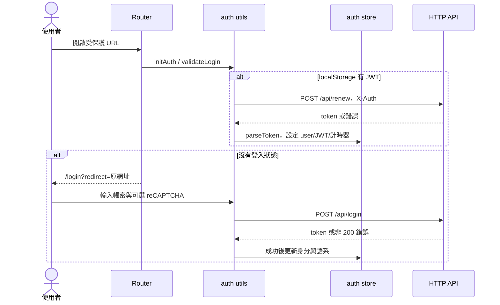
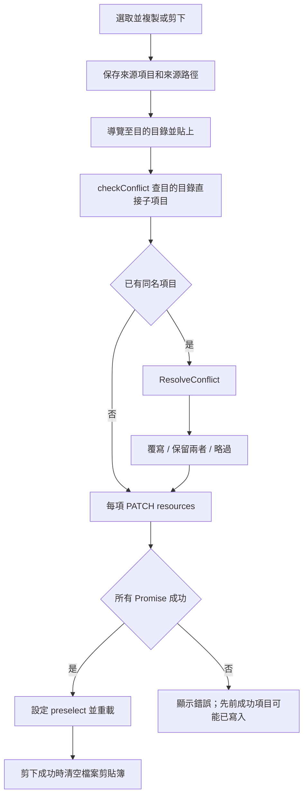
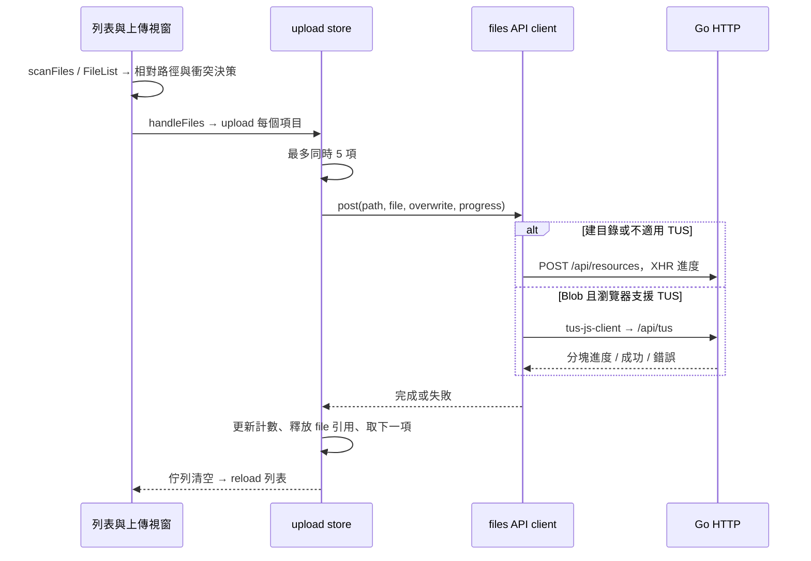

# File Browser 使用流程與狀態管理

本報告將 File Browser 的操作拆成「使用者觸發 → 前端狀態 → API → 後端處理 → 畫面回饋」，供 FileHub 改寫時建立路由、元件、服務與驗收情境。主要可借鑑的是路徑導向的工作空間、操作後重新載入並定位項目、上傳佇列，以及跨頁保留的檔案剪貼簿。

分析基準為本機 `C:\Users\win10\Desktop\Github\filebrowser`，Git commit `833d908884d5c801f30f5c098d7977177eb3a36b`。本報告的「來源現況」均由該版本原始碼確認；沒有把靜態分析當成瀏覽器實測。實際畫面與 REA 證據由本系列其他報告補充。「FileHub 建議」是重寫設計，尚未實作。

## 1. 路由如何決定工作情境

| 路由 | 用途 | 來源端的存取條件 |
| --- | --- | --- |
| `/login` | 登入 | 已登入者導回 `/files/` |
| `/files/:path*` | 目錄、預覽、編輯共用入口 | `requiresAuth` |
| `/share/:path*` | 公開分享瀏覽 | 不要求一般帳號登入；分享權限另由後端處理 |
| `/settings/profile` | 個人偏好及密碼 | 登入 |
| `/settings/shares` | 分享管理 | 登入；後端另驗證分享操作權限 |
| `/settings/global` | 全域設定 | 登入且管理員 |
| `/settings/users`、`/settings/users/:id` | 帳號清單及編輯 | 登入且管理員 |
| `/403`、`/404`、`/500` | 錯誤頁 | 依頁面組態 |

第一次解析路由時，`initAuth()` 先嘗試還原登入；路由守衛再依 `requiresAuth`、`requiresAdmin` 決定是否轉向。未登入會保留 `redirect=to.fullPath`。`/files` 並非一頁固定列表：`Files.vue` 取得資源後，目錄顯示 `FileListing`，文字顯示 `Editor`，其餘顯示 `Preview`；CSV 預設預覽，`?edit=true` 才進編輯器。

來源：[router/index.ts:35–170、183–218](https://github.com/filebrowser/filebrowser/blob/833d908884d5c801f30f5c098d7977177eb3a36b/frontend/src/router/index.ts#L35)、[Files.vue:49–85](https://github.com/filebrowser/filebrowser/blob/833d908884d5c801f30f5c098d7977177eb3a36b/frontend/src/views/Files.vue#L49)。

**FileHub 建議：**保留可分享、可重新整理的路徑導向 URL；將瀏覽、預覽及編輯模式明確建模。前端 route guard 僅負責導覽體驗，每支 API 仍需自行驗證身分、入口授權及操作權限。

## 2. 共用狀態與局部狀態

| 狀態範圍 | 來源實作 | 責任與注意事項 |
| --- | --- | --- |
| 登入 | `stores/auth.ts` | `user`、`jwt`、`logoutTimer`；`isLoggedIn` 由 user 是否存在判斷 |
| 檔案工作空間 | `stores/file.ts` | `req`、`oldReq`、`selected:number[]`、`multiple`、`reload`、`preselect` |
| 檔案剪貼簿 | `stores/clipboard.ts` | `key` 區分剪下／複製，`items` 保存來源，`path` 保存原目錄；這不是系統剪貼簿 |
| 版面與浮層 | `stores/layout.ts` | `loading`、`prompts` 堆疊、`showShell`；`closeHovers()` 只 pop 最上層，不是全部清空 |
| 上傳 | `stores/upload.ts` | 待傳及傳送中項目、總位元組、已傳位元組、排程與進度同步 |
| 元件局部 | `FileListing`、`Preview`、`Editor` | 顯示筆數、右鍵位置、媒體前後項目、編輯器、未儲存內容等 |

`file.updateRequest()` 先保存舊項目，再以 URL 對應新項目，重建選取索引。一般 `Files.fetchData()` 又會先清空選取，因此操作後定位主要靠 `preselect` 與 `oldReq`。重寫時應將「伺服器資源」、「選取集合」、「載入狀態」、「操作結果」分開，避免單一 `reload:boolean` 失去是哪個操作要求更新的資訊。

來源：[stores/file.ts:3–65](https://github.com/filebrowser/filebrowser/blob/833d908884d5c801f30f5c098d7977177eb3a36b/frontend/src/stores/file.ts#L3)、[stores/clipboard.ts:3–24](https://github.com/filebrowser/filebrowser/blob/833d908884d5c801f30f5c098d7977177eb3a36b/frontend/src/stores/clipboard.ts#L3)、[stores/layout.ts:5–84](https://github.com/filebrowser/filebrowser/blob/833d908884d5c801f30f5c098d7977177eb3a36b/frontend/src/stores/layout.ts#L5)。

**FileHub 建議：**選取使用穩定資源 ID 或標準化路徑，避免以當前陣列索引作為跨重載身分。Modal／Drawer 的表單草稿保持局部狀態；跨路徑保留的剪貼簿與上傳任務才放共用狀態。

## 3. 登入、還原與登出

來源現況：`parseToken()` 解碼 token、寫入 JavaScript 可存取的 `auth` cookie 與 `localStorage.jwt`，再更新 store；依 `exp` 設定登出計時器。`fetchURL()` 加入 `X-Auth`；若回應 `X-Renew-Token:true` 會等待 renew，401 會呼叫 logout。`logout()` 清除瀏覽器的 cookie／store／localStorage，再依設定導向登入、外部登出頁或重新整理；這段流程沒有送出撤銷 session 的 API。

來源：[utils/auth.ts:9–95、118–141](https://github.com/filebrowser/filebrowser/blob/833d908884d5c801f30f5c098d7977177eb3a36b/frontend/src/utils/auth.ts#L9)、[api/utils.ts:17–63](https://github.com/filebrowser/filebrowser/blob/833d908884d5c801f30f5c098d7977177eb3a36b/frontend/src/api/utils.ts#L17)。

**FileHub 建議：**借鑑登入後返回原路徑與統一 401 處理；身分保存與撤銷機制應重新設計。若採 server-side session，需驗收登出、改密碼、管理員停用後舊連線立即失效。多個 API 同時要求 renew 應共用同一個更新 Promise，避免互相覆蓋 token 或重複導頁。

## 4. 瀏覽、重載、排序與顯示模式

1. 元件掛載、route 改變或 `reload=true` 都進入 `Files.fetchData()`。
2. 重置多選與浮層，設定 loading，清除前次錯誤；中止前一次 `AbortController`。
3. `api.files.fetch()` 移除 `/files` 前綴，呼叫 `GET /api/resources{path}`。文字編碼情境可能收到 octet-stream，再組成資源；目錄回應補上每筆 `index` 與 URL。
4. 更新 store、頁面標題、loading；`applyPreSelection()` 選取操作後目標，或返回父目錄時選取剛離開的子目錄。
5. 取消請求不顯示錯誤；其他錯誤交給錯誤頁。

來源：[Files.vue:89–176](https://github.com/filebrowser/filebrowser/blob/833d908884d5c801f30f5c098d7977177eb3a36b/frontend/src/views/Files.vue#L89)、[api/files.ts:8–53](https://github.com/filebrowser/filebrowser/blob/833d908884d5c801f30f5c098d7977177eb3a36b/frontend/src/api/files.ts#L8)。

列表初始 `showLimit=50`，視窗填滿與捲動時增加「渲染」數量；這不是向後端逐頁取得資料。排序會 `PUT /api/users/{id}` 更新 `sorting` 偏好，再重載目錄。顯示模式在 `list → mosaic → mosaic gallery → list` 間切換，送出使用者偏好更新，同時立即更新 auth store；更新失敗只顯示錯誤，該段沒有回滾本地模式。

來源：[FileListing.vue:375、497–510、748–767、934–962、1018–1038](https://github.com/filebrowser/filebrowser/blob/833d908884d5c801f30f5c098d7977177eb3a36b/frontend/src/views/files/FileListing.vue#L934)。

**FileHub 建議：**loading／empty／error 與「目前路徑」綁定，舊路徑的晚回應不得覆蓋新路徑；除了 AbortController，也以請求代次核對結果。大型目錄若需真正分頁，API 契約要包含 page/cursor、排序及篩選條件，不能只移植顯示 50 筆的做法。

## 5. 開啟、多選、快捷鍵與操作可用性

來源依使用者 `singleClick` 偏好決定單擊直接開啟，或先選取、短時間內再次點擊開啟。Ctrl／Command 切換個別選取；Shift 從第一個選取索引延伸區間；多選模式下點擊切換選取；長按另有選取處理。`open()` 透過 router 進入項目 URL，之後由 `Files` 決定列表、預覽或編輯。

快捷鍵包含 Esc 清空、Delete 開刪除確認、F2 重新命名、Ctrl／Command+C/X/V 檔案剪貼簿、Ctrl／Command+A 全選、Ctrl／Command+S 觸發下載、Ctrl／Command+Shift+F 搜尋、F1 說明。有 prompt 時列表快捷鍵提早返回。

來源：[ListingItem.vue:242–329](https://github.com/filebrowser/filebrowser/blob/833d908884d5c801f30f5c098d7977177eb3a36b/frontend/src/components/files/ListingItem.vue#L242)、[FileListing.vue:554–617](https://github.com/filebrowser/filebrowser/blob/833d908884d5c801f30f5c098d7977177eb3a36b/frontend/src/views/files/FileListing.vue#L554)。

工具列用權限及選取數量控制：rename、share 限單選；share 另要求 share 與 download；move 依 rename、copy 依 create；delete 依 delete。這些是可見性規則，後端仍會檢查。

**FileHub 建議：**先定義固定的單擊／雙擊政策再做偏好；快捷鍵需排除 input、textarea、contenteditable 與開啟中的對話框，並明確管理焦點。來源 `copyCut()`、`paste()` 只特別排除 input，不能據此宣稱所有文字輸入情境都安全。

## 6. 複製、剪下、貼上與衝突決策

`copyCut()` 將已選項目的來源 URL、名稱、大小、類型及時間存入 clipboard store。導覽到其他目錄不會重建此 store，因此可貼上；它與 `utils/clipboard.ts` 操作系統文字剪貼簿的功能不同。

API 以每項來源執行 `PATCH /api/resources{from}?action=copy|rename&destination=...&override=...&rename=...`，透過 `Promise.all()` 等待。移動及重新命名共用 `action=rename`；`rename=true` 代表衝突時加版本後綴，與 action 名稱的意思不同。貼到來源目錄時會為項目設定保留兩者旗標。剪下只有整批成功的 then 才 resetClipboard。

衝突結果由 `checked` 表示：只有 origin 為覆寫，origin+dest 為保留兩者，其餘為略過。後端仍重新檢查來源／目的權限、根路徑、父子關係與目的存在性；預檢後又產生同名項目仍可回 409。

來源：[FileListing.vue:624–734](https://github.com/filebrowser/filebrowser/blob/833d908884d5c801f30f5c098d7977177eb3a36b/frontend/src/views/files/FileListing.vue#L624)、[api/files.ts:174–204](https://github.com/filebrowser/filebrowser/blob/833d908884d5c801f30f5c098d7977177eb3a36b/frontend/src/api/files.ts#L174)、[resource.go:222–274](https://github.com/filebrowser/filebrowser/blob/833d908884d5c801f30f5c098d7977177eb3a36b/http/resource.go#L222)。

**FileHub 建議：**批次操作應回傳逐項結果與任務 ID；部分成功不能只顯示整批錯誤。重試只包含失敗項目，避免重複複製。目的衝突檢查是使用體驗，實際防覆寫需在寫入時保證。

## 7. 上傳、資料夾、TUS 與進度

### 7.1 加入與預檢

檔案選取器把 FileList 轉為 UploadList；資料夾選取保留 `webkitRelativePath`。拖放使用 `scanFiles()` 遞迴掃描 FileSystemEntry，保留資料夾與子路徑。送出前先讓 upload 按鈕進入 loading，再 `checkConflict()`；平面上傳只取得目的目錄，確有子路徑的資料夾上傳才讀取遞迴目錄。預檢使用未編碼的相對路徑比對，並正規化 Windows 反斜線。

預檢的 catch 會把讀取失敗視為無衝突；它沒有區分 404、403、網路中斷。因此不能把「沒有顯示衝突視窗」等同「目的地已確認可寫」。

來源：[FileListing.vue:789–924](https://github.com/filebrowser/filebrowser/blob/833d908884d5c801f30f5c098d7977177eb3a36b/frontend/src/views/files/FileListing.vue#L789)、[utils/upload.ts:20–143、151–233](https://github.com/filebrowser/filebrowser/blob/833d908884d5c801f30f5c098d7977177eb3a36b/frontend/src/utils/upload.ts#L20)。

### 7.2 執行與傳輸分支

來源 `UPLOADS_LIMIT=5` 是跨檔案同時傳輸上限；每個 TUS upload 的 `parallelUploads=1`。上傳中註冊 beforeunload 提醒；位元組進度先寫入 `markRaw` 物件，每秒同步成響應式狀態。失敗只計算實際已傳位元組，並扣除尚未傳送的剩餘量；佇列全部結束後重置統計並重載。這份 store 沒有持久保留逐項成功／失敗歷史，佇列結束會走 `buttons.success("upload")`，不應將此按鈕狀態解讀為每一項都成功。

來源：[stores/upload.ts:8–10、36–73、96–184](https://github.com/filebrowser/filebrowser/blob/833d908884d5c801f30f5c098d7977177eb3a36b/frontend/src/stores/upload.ts#L8)、[api/files.ts:106–172](https://github.com/filebrowser/filebrowser/blob/833d908884d5c801f30f5c098d7977177eb3a36b/frontend/src/api/files.ts#L106)。

### 7.3 衝突、重試與取消不能混為一談

| 能力 | 來源現況 | 改寫時應明確定義 |
| --- | --- | --- |
| 複製／移動衝突 | 覆寫、保留兩者、略過 | 與上傳政策是否一致 |
| 上傳衝突 | 覆寫或略過；保留兩者在 UI 中不開放 | 若 FileHub 要支援保留兩者，需後端決定新路徑 |
| `resumeTransfer` 按鈕 | 來源比目的大時選覆寫，否則略過 | 這是大小判斷，不是 checksum 驗證，也不能據此聲稱跨重啟續傳 |
| TUS 重試 | 指數等待，從 0、1000、2000…ms 起，封頂 20000ms；次數由設定決定；409 不重試 | 哪些錯誤可重試、身分過期如何處理 |
| TUS 持久恢復 | `storeFingerprintForResuming:false` | 瀏覽器重啟後續傳需另有身分、upload ID 與清理政策 |
| 取消全部 | 阻止待傳項目開始，呼叫 TUS `abort(true)` | XHR 分支沒有被此集合管理，不能宣稱所有傳輸都會立即取消 |

來源：[ResolveConflict.vue:48–65、99–124、207–222](https://github.com/filebrowser/filebrowser/blob/833d908884d5c801f30f5c098d7977177eb3a36b/frontend/src/components/prompts/ResolveConflict.vue#L48)、[api/tus.ts:30–81、85–122](https://github.com/filebrowser/filebrowser/blob/833d908884d5c801f30f5c098d7977177eb3a36b/frontend/src/api/tus.ts#L30)。

**FileHub 建議：**每項工作採明確狀態 `queued → checking → uploading → succeeded|failed|canceled`，失敗保留錯誤與重試入口；總完成狀態應區分全成功、部分失敗及使用者取消。採用 TUS 前須先定義伺服器持久化、quota、到期清理與斷點完整性。

## 8. 新增、重新命名與刪除

新增目錄或檔案使用 `POST /api/resources{path}`；目錄路徑以 `/` 結尾。重新命名視窗排除空字串及未修改名稱，組成同父目錄新 URL，呼叫 `api.move()`。列表情境設定 preselect 再 reload；預覽／編輯情境則直接導向新 URL。錯誤以 toast 呈現。

刪除先開確認視窗；列表對每個選取 URL 呼叫 DELETE 並 Promise.all。部分失敗時仍要求 reload，以顯示已完成的刪除。Go `resourceDeleteHandler` 檢查權限與子路徑，清除對應分享及縮圖，再呼叫 `Fs.RemoveAll`；成功回 204。**這是永久檔案刪除流程，該 handler 沒有垃圾桶／還原步驟。**

來源：[Rename.vue:89–119](https://github.com/filebrowser/filebrowser/blob/833d908884d5c801f30f5c098d7977177eb3a36b/frontend/src/components/prompts/Rename.vue#L89)、[Delete.vue:57–95](https://github.com/filebrowser/filebrowser/blob/833d908884d5c801f30f5c098d7977177eb3a36b/frontend/src/components/prompts/Delete.vue#L57)、[resource.go:88–129](https://github.com/filebrowser/filebrowser/blob/833d908884d5c801f30f5c098d7977177eb3a36b/http/resource.go#L88)。

**FileHub 建議：**刪除政策應在需求階段決定。若要求可還原，需額外設計垃圾桶 metadata、來源入口、權限、容量與還原衝突；不能只把 RemoveAll 的按鈕文字改成「移至垃圾桶」。

## 9. 下載與打包

單一普通檔案直接開啟 `/api/raw{path}`；多檔、目錄或未選項目時先開打包格式視窗，再組合 `files` 清單與 `algo`。未選項目代表當前目錄。下載透過 `window.open()` 交給瀏覽器，不進入 upload store；前端沒有因視窗開啟便取得下載完成證明。

來源：[FileListing.vue:987–1015](https://github.com/filebrowser/filebrowser/blob/833d908884d5c801f30f5c098d7977177eb3a36b/frontend/src/views/files/FileListing.vue#L987)、[api/files.ts:82–104](https://github.com/filebrowser/filebrowser/blob/833d908884d5c801f30f5c098d7977177eb3a36b/frontend/src/api/files.ts#L82)。

**FileHub 建議：**一般下載保留瀏覽器原生流程；大型打包若需進度、取消與重試，新增伺服器背景任務與下載產物狀態，不能將 `window.open()` 包成進度百分比。

## 10. 分享的建立與公開存取

已登入者開分享視窗後先 `GET /api/share{path}` 列出既有連結；建立時 `POST` 同一路徑，body 可含 password、expires、unit。刪除連結使用 `DELETE /api/share/{hash}`。分享 URL 是目前 origin/baseURL 下的 `/share/{hash}`，不是另一套 SPA。

公開頁使用 `GET /api/public/share{hash/path}`，將輸入密碼 URI encode 後放在 `X-SHARE-PASSWORD` header；成功回傳的資源 token 保存在頁面狀態，公開下載用 `/api/public/dl/{hash}{path}` 並可帶 token。`fetchURL(..., false)` 表示不採一般登入的 renew／401 logout 規則；它本身仍統一加上 `X-Auth` header，因此不應解釋成絕對不發送任何帳號資訊。

來源：[api/share.ts:3–44](https://github.com/filebrowser/filebrowser/blob/833d908884d5c801f30f5c098d7977177eb3a36b/frontend/src/api/share.ts#L3)、[api/pub.ts:4–74](https://github.com/filebrowser/filebrowser/blob/833d908884d5c801f30f5c098d7977177eb3a36b/frontend/src/api/pub.ts#L4)、[Share.vue:397–428](https://github.com/filebrowser/filebrowser/blob/833d908884d5c801f30f5c098d7977177eb3a36b/frontend/src/views/Share.vue#L397)。

**FileHub 建議：**公開分享採獨立 API client 與獨立權限上下文；定義期限、密碼錯誤、撤銷、檔案搬移／刪除後行為。分享 token 若置於 URL，需同步規劃 access log、referer 與快取政策。

## 11. 預覽、編輯與離開保護

`Preview` 依檔案類型組成原始內容或大圖預覽 URL；前後切換會取得父目錄，選出支援媒體項目並建立 previous／next URL，也為相鄰項目設 prefetch。圖片縮圖透過 `/api/preview/thumb{path}`，修改時間作為 URL key。PDF、EPUB、CSV 等由不同預覽分支處理；CSV 來源設有 5 MiB 上限，不能推廣成所有預覽檔案通用上限。

編輯器以 Ace 管理文字與 undo dirty state。Save 呼叫 `PUT /api/resources{path}`；成功才 `markClean()`。關閉若有未儲存內容，提供捨棄或先儲存；儲存失敗會留在編輯器。重新整理／關閉分頁透過 beforeunload 提醒。這與對所有可能的路由跳轉都有完整防護是不同主張，仍需逐條實測。

來源：[Preview.vue:206、285–323、405–474](https://github.com/filebrowser/filebrowser/blob/833d908884d5c801f30f5c098d7977177eb3a36b/frontend/src/views/files/Preview.vue#L285)、[Editor.vue:260–321](https://github.com/filebrowser/filebrowser/blob/833d908884d5c801f30f5c098d7977177eb3a36b/frontend/src/views/files/Editor.vue#L260)、[api/files.ts:211–234](https://github.com/filebrowser/filebrowser/blob/833d908884d5c801f30f5c098d7977177eb3a36b/frontend/src/api/files.ts#L211)。

**FileHub 建議：**編輯 API 加入內容版本／ETag，避免兩位使用者或兩個分頁互相覆寫；預覽與下載權限分開定義；Markdown 顯示保留 HTML 清理邊界。大型或不支援格式應明確提供下載，避免無限 loading。

## 12. 搜尋與管理流程

搜尋從當前目錄送 `GET /api/search{base}?query=...`，以 `AbortSignal` 取消舊搜尋。client 優先串流讀取並按換行解析 JSON，邊讀邊 callback 加入結果；不支援串流的分支才等待完整文字。這是伺服器搜尋，與只過濾目前已載入檔名不同。增量 parser 應特別驗收跨 chunk 的 UTF-8、最後一列無換行，以及取消後舊結果是否仍寫入。

來源：[api/search.ts:4–72](https://github.com/filebrowser/filebrowser/blob/833d908884d5c801f30f5c098d7977177eb3a36b/frontend/src/api/search.ts#L4)。

| 管理情境 | 來源流程 | 改寫重點 |
| --- | --- | --- |
| 個人偏好 | `Profile.vue` 讀取目前使用者，PUT users 指定 `which` 欄位 | 草稿與已保存偏好分開；儲存失敗不顯示成功 |
| 修改密碼 | 輸入目前密碼與新密碼確認，PUT users `which:[password]` | 成功後撤銷哪些 session 應有後端契約 |
| 帳號管理 | Users 讀清單；User 讀使用者或全域 defaults，建立／更新／刪除時帶 current_password | 管理員 route guard 加 API 權限；避免提交未修改敏感欄位 |
| 全域設定 | GET settings 建草稿，轉換輸入後 PUT settings | 哪些立即生效、哪些需重新載入，需逐項定義 |
| 分享管理 | GET shares；管理員另讀使用者清單顯示擁有者 | 撤銷要等待 API 成功才移除畫面項目 |

來源：[api/users.ts:3–54](https://github.com/filebrowser/filebrowser/blob/833d908884d5c801f30f5c098d7977177eb3a36b/frontend/src/api/users.ts#L3)、[Profile.vue:146–214](https://github.com/filebrowser/filebrowser/blob/833d908884d5c801f30f5c098d7977177eb3a36b/frontend/src/views/settings/Profile.vue#L146)、[User.vue:91–205](https://github.com/filebrowser/filebrowser/blob/833d908884d5c801f30f5c098d7977177eb3a36b/frontend/src/views/settings/User.vue#L91)、[Global.vue:330–431](https://github.com/filebrowser/filebrowser/blob/833d908884d5c801f30f5c098d7977177eb3a36b/frontend/src/views/settings/Global.vue#L330)、[Shares.vue:86–146](https://github.com/filebrowser/filebrowser/blob/833d908884d5c801f30f5c098d7977177eb3a36b/frontend/src/views/settings/Shares.vue#L86)。

## 13. FileHub 可直接轉為需求的驗收矩陣

以下是待實作的驗收情境，並非本次已通過的測試。

| 流程 | 必驗情境 | 可觀察結果 |
| --- | --- | --- |
| 登入 | 過期連線、返回深層路徑、並發 401 | 單次導頁；不遺失 redirect；舊 session 按契約失效 |
| 瀏覽 | 快速 A→B→C、返回父目錄、目錄刪除 | 最後路徑決定畫面；舊請求不覆蓋；目標仍存在時恢復焦點 |
| 選取 | 排序後選取、多選、Shift、鍵盤輸入框 | 依穩定身分維持或明確清空；不誤刪輸入中的資料 |
| 貼上 | 同目錄、跨目錄、衝突、部分成功、重試 | 逐項結果；剪下只清理成功來源；不重複處理已成功項目 |
| 上傳 | 空資料夾、特殊字元、深層路徑、同名競態 | 路徑保持一致；最終寫入重新驗證；衝突選項與後端一致 |
| 傳輸 | 中斷、重新整理、取消、權限過期、容量不足 | 明確 succeeded／failed／canceled；取消範圍可證明 |
| 刪除 | 多項中一項失敗、根目錄、無權限子項 | 不刪錯範圍；部分結果正確；若有垃圾桶能完整還原 |
| 分享 | 密碼錯、過期、撤銷、來源搬移／刪除 | 狀態明確；撤銷後舊 URL 依契約失效 |
| 編輯 | 未儲存離開、儲存失敗、另一分頁修改 | 不靜默丟失；衝突可見；成功才標記已儲存 |
| 搜尋 | 連續查詢、串流中取消、無結果、大量結果 | 舊結果不混入；取消非錯誤；資源使用受控 |

優先實作順序可採：登入與授權 → 目錄與選取 → 基礎上下載 → 衝突與批次任務 → 預覽編輯 → 分享 → 管理設定。每階段先固定 API 與錯誤契約，再接 UI；File Browser 的類似畫面不能代替 FileHub 的權限與資料一致性設計。
