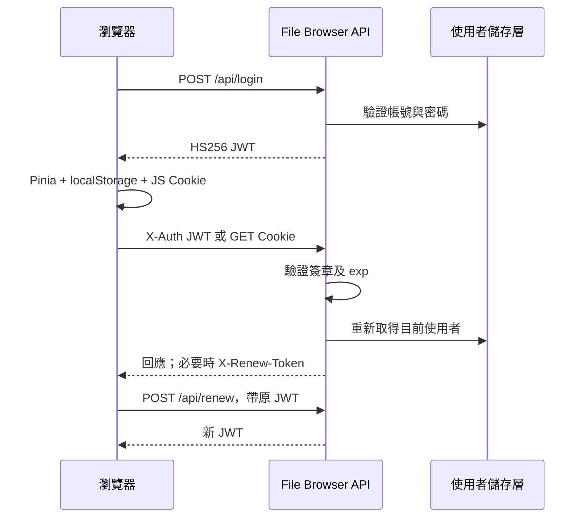

# File Browser 安全邊界與 FileHub 重寫取捨

本報告供 FileHub 改寫時決定哪些行為可借鑑、哪些必須重新設計。核心結論是：保留「伺服器端權限判斷、使用者檔案根目錄隔離、分享範圍再縮小」的概念；重新設計登入連線、權杖保存與撤銷；第一版不引入可執行主機指令的 runner 或 hooks。

## 1. 分析基準與證據範圍

| 項目 | 本報告的範圍 |
| --- | --- |
| 本機來源 | `C:\Users\win10\Desktop\Github\filebrowser` |
| 原始碼基準 | `833d908884d5c801f30f5c098d7977177eb3a36b` |
| 上游 | `https://github.com/filebrowser/filebrowser.git` |
| 日期 | 2026-10-27，Asia/Taipei |
| 驗證方式 | 閱讀指定版本的程式碼、README、LICENSE 與測試案例；沒有在本報告中執行安全攻擊、Go 測試或滲透測試 |

下文的「來源確認」指程式碼中存在該邏輯；「README 自述」指維護者在此快照寫下的聲明；「改寫建議」指 FileHub 尚未實作的新設計。原始碼中存在測試不代表本次已執行通過。REA 的畫面與執行期結果由整份研究的執行期證據另行記錄，本篇不以靜態推論代替執行期觀察。

### 維護狀態

**README 自述：** 此版本宣告專案於 2026-09-01 封存，後續不再提供版本、Bug 修正或安全修正；並把 command execution 與 session/JWT 列為未解決的問題類別。這是本機指定 commit 的內容，並非本報告獨立查詢 GitHub 封存旗標或逐條重驗外部公告的結果。[README.md:1–26](https://github.com/filebrowser/filebrowser/blob/833d908884d5c801f30f5c098d7977177eb3a36b/README.md#L1-L26)

因此 File Browser 適合作為行為與架構研究來源；若 FileHub 要直接依賴或 fork 此實作，便需自行負責後續維護。重新寫一個相似介面，與持續使用整個封存後端，是不同的工程選擇。

## 2. 登入連線與 JWT 的實際做法

### 2.1 原始流程

1. `login()` 以 JSON 傳送使用者名稱、密碼與選填 reCAPTCHA 到 `/api/login`。
2. 後端依設定取得 authentication provider，成功後呼叫 `printToken()`。
3. JWT 內含使用者資訊與 `iat`、`exp`、issuer，採 HS256；預設有效時間為兩小時，但可由 server 設定改變。
4. 前端 `parseToken()` 把 JWT 存入 Pinia、`localStorage.jwt`，另用 JavaScript 設定 `auth` Cookie。
5. API client 加上 `X-Auth`；直接 GET 下載等情境可以使用 Cookie。
6. 後端 `withUser()` 驗證簽章與必要的到期時間，接著重新從使用者儲存層取得使用者。
7. 剩餘時間少於一小時，或使用者資料更新晚於 JWT 的簽發時間時，回傳 `X-Renew-Token: true`；前端以既有 JWT 呼叫 `/api/renew` 取得新 JWT。

來源：[http/auth.go:21–24、49–67、116–143、245–285](https://github.com/filebrowser/filebrowser/blob/833d908884d5c801f30f5c098d7977177eb3a36b/http/auth.go#L116-L143)、[前端 auth.ts:9–38、51–95](https://github.com/filebrowser/filebrowser/blob/833d908884d5c801f30f5c098d7977177eb3a36b/frontend/src/utils/auth.ts#L9-L95)、[API client:17–63](https://github.com/filebrowser/filebrowser/blob/833d908884d5c801f30f5c098d7977177eb3a36b/frontend/src/api/utils.ts#L17-L63)。

### 2.2 需要精確區分的兩件事

**權限更新與 token 撤銷不同。** JWT 雖含 `Perm` 快照，後端 `withUser()` 會重新載入使用者；實際 handler 使用 `d.user.Perm`。不能據此宣稱「修改權限後所有 API 仍一直使用舊權限」。但 `LastUpdate` 在此處只觸發更新提示，沒有拒絕舊 token 的處理；也沒有把每次登入建立為可撤銷的 session 記錄。[http/auth.go:129–142](https://github.com/filebrowser/filebrowser/blob/833d908884d5c801f30f5c098d7977177eb3a36b/http/auth.go#L129-L142)

**登出是本機清除。** `logout()` 刪除 Cookie、清除 Pinia 與 localStorage，再切換頁面；函式內沒有向伺服器送出撤銷請求。後端本版本的路由也沒有對應 logout endpoint。這支持 README 對已簽發 JWT 無法個別撤銷的描述，但本次沒有拿複製 token 實際重播測試。[前端 auth.ts:118–141](https://github.com/filebrowser/filebrowser/blob/833d908884d5c801f30f5c098d7977177eb3a36b/frontend/src/utils/auth.ts#L118-L141)、[http/http.go:49–94](https://github.com/filebrowser/filebrowser/blob/833d908884d5c801f30f5c098d7977177eb3a36b/http/http.go#L49-L94)

### 2.3 FileHub 的改寫建議

| 設計項目 | 建議行為 | 必要驗收 |
| --- | --- | --- |
| 連線模型 | 伺服器保存可撤銷 session，或 JWT 對應可撤銷 session ID；失效必須由伺服器判定 | 複製舊憑證，登出後重播應失敗；不同 session 的撤銷範圍符合設定 |
| 瀏覽器保存 | 由伺服器發送 HttpOnly Cookie，正式 HTTPS 使用 Secure；前端不保存可重播憑證至 localStorage | JavaScript 無法讀取 session Cookie；一般重新整理仍維持登入 |
| 改密碼 | 驗證目前密碼，完成後撤銷其他或全部 session，規則需明定 | 舊 session 在下一個 API 請求失效；不能只更新畫面 |
| 更新期限 | 如採 refresh token，保存 rotation 狀態與重播判定；不要只反覆交換同一 bearer token | 第二次使用已消耗 refresh token 被拒絕 |
| Cookie 寫入 API | 明確設計同源／Origin／CSRF 驗證；不能把 JS 自訂 header 視為完整防護 | 跨站表單與跨站 fetch 無法執行修改操作；合法同源請求可用 |
| 登入失敗 | 獨立的限流、通用錯誤、稽核與可控重試 | 密集失敗達門檻後節流，紀錄不含密碼與憑證 |

這是新的安全模型；不能機械地把目前 `X-Auth` 改為 Cookie 就視為完成。

## 3. 帳號、角色與檔案授權

### 3.1 可借鑑的伺服器端檢查

`Permissions` 分為 `Admin`、`Execute`、`Create`、`Rename`、`Modify`、`Delete`、`Share`、`Download`。使用者另有 `Scope` 與路徑規則。前端隱藏按鈕只是操作提示，後端仍在 handler 判斷權限。[users/permissions.go:4–13](https://github.com/filebrowser/filebrowser/blob/833d908884d5c801f30f5c098d7977177eb3a36b/users/permissions.go#L4-L13)、[users/users.go:20–38](https://github.com/filebrowser/filebrowser/blob/833d908884d5c801f30f5c098d7977177eb3a36b/users/users.go#L20-L38)

| 操作 | 來源確認的主要檢查 | 對 FileHub 的啟示 |
| --- | --- | --- |
| 管理員 API | `withAdmin()` 在 `withUser()` 之後判斷目前 `Perm.Admin` | 每個管理 API 保留後端角色檢查 |
| 刪除 | 禁止根目錄，要求 `Delete`，並檢查受影響子樹的規則 | 不能只檢查使用者點選的父資料夾 |
| 複製 | `patchAction(copy)` 要求 `Create`；來源和目的地須通過檢查 | 來源讀取與目的地寫入分開授權 |
| 改名／搬移 | `patchAction(rename)` 要求 `Rename`，來源及目的地都需檢查 | 跨授權入口搬移不可只看其中一邊 |
| 覆寫 | `override=true` 時另外要求 `Modify` | 「可新增」不等於「可覆寫」 |
| 分享 | 同時要求 `Share` 與 `Download` | 分享本質是授予他人下載能力 |

來源：[http/auth.go:146–154](https://github.com/filebrowser/filebrowser/blob/833d908884d5c801f30f5c098d7977177eb3a36b/http/auth.go#L146-L154)、[http/resource.go:88–129、222–311、390–425](https://github.com/filebrowser/filebrowser/blob/833d908884d5c801f30f5c098d7977177eb3a36b/http/resource.go#L222-L311)、[http/share.go:52–59](https://github.com/filebrowser/filebrowser/blob/833d908884d5c801f30f5c098d7977177eb3a36b/http/share.go#L52-L59)。

### 3.2 規則的順序值得保留為明確決策

`CheckRules()` 起始為允許，先逐條套用全域規則，再逐條套用使用者規則；每個匹配規則直接覆蓋 `allow`。因此它是「最後匹配生效」，使用者規則也可能覆蓋先前全域結果，不能描述成「全域 deny 永遠優先」。`HideDotfiles` 則是顯示偏好，`CheckRules()` 故意不把它當作遞迴操作的拒絕規則。[http/data.go:36–84](https://github.com/filebrowser/filebrowser/blob/833d908884d5c801f30f5c098d7977177eb3a36b/http/data.go#L36-L84)

**FileHub 建議：** 權限介面應能解釋有效結果，明確決定 deny/allow 優先順序；不要直接複製此排序語意卻在 UI 上顯示成全域封鎖。若要多目錄授權，需另設授權入口模型；File Browser 此處的一個 `Scope` 並不等於 FileHub 的多入口 ACL。

帳號管理還應保留欄位級授權。此版本禁止一般使用者修改 `Username`、`Scope`、`LockPassword`、`Perm`、`Commands`、`Rules` 等欄位，敏感修改在 JSON 認證模式下要求目前密碼；自行註冊也強制移除 Admin 與 Execute。[http/users.go:22、186–263](https://github.com/filebrowser/filebrowser/blob/833d908884d5c801f30f5c098d7977177eb3a36b/http/users.go#L186-L263)、[http/auth.go:205–219](https://github.com/filebrowser/filebrowser/blob/833d908884d5c801f30f5c098d7977177eb3a36b/http/auth.go#L205-L219)

## 4. 路徑與符號連結隔離

### 4.1 此版本已有的保護

`User.Clean()` 以 server root 加上 user scope 建立使用者檔案系統。`NewFs()` 在未允許外部連結時回傳 `ScopedFs`，並非僅把請求路徑加到一個字串根目錄。[users/users.go:92–104](https://github.com/filebrowser/filebrowser/blob/833d908884d5c801f30f5c098d7977177eb3a36b/users/users.go#L92-L104)、[files/scoped.go:14–48](https://github.com/filebrowser/filebrowser/blob/833d908884d5c801f30f5c098d7977177eb3a36b/files/scoped.go#L14-L48)

`ScopedFs.within()` 的處理包括：

- 對根目錄與目標執行實體 symlink 解析。
- 目標尚未存在時，檢查最近存在的祖先；若是 dangling symlink，改追蹤其目的地。
- 相對 symlink 依「實際所在父目錄」解析，避免祖先本身是 symlink 時判斷錯誤。
- 限制 dangling symlink 跳轉次數為 255。
- 以含分隔符的根目錄前綴比較，避免把 `/srv-other` 當作 `/srv` 的子目錄。
- `Create`、`OpenFile`、`Rename`、`RemoveAll` 等入口先執行 `guard()`；改名檢查兩邊。

來源：[files/scoped.go:73–156、159–252](https://github.com/filebrowser/filebrowser/blob/833d908884d5c801f30f5c098d7977177eb3a36b/files/scoped.go#L73-L156)。

請求路徑也會經過 `canonicalizeRequestPath()`，把規則判斷、檔案操作、hook 與快取使用的虛擬路徑統一；保留尾端 `/`，因為建立資料夾的判斷需要它。Windows 分隔符與 POSIX 合法反斜線檔名的語意不同，來源有刻意處理。[http/utils.go:17–44](https://github.com/filebrowser/filebrowser/blob/833d908884d5c801f30f5c098d7977177eb3a36b/http/utils.go#L17-L44)

### 4.2 不應過度宣稱的範圍

此處能確認的是「先檢查，再呼叫底層路徑操作」的防護邏輯。它不能單憑靜態閱讀證明對抗任意本機惡意程序在兩步之間替換 symlink 的競態安全，也不能代表 Windows junction、網路磁碟、所有大小寫行為都已在本次執行驗證。

來源提供 `followExternalSymlinks` 開關，預設為 false；設為 true 時改用裸 `BasePathFs`，會允許外部 symlink。FileHub 第一版建議不提供此放寬選項，除非之後明確設計獨立掛載入口。[cmd/root.go:109–115](https://github.com/filebrowser/filebrowser/blob/833d908884d5c801f30f5c098d7977177eb3a36b/cmd/root.go#L109-L115)、[files/scoped.go:40–47](https://github.com/filebrowser/filebrowser/blob/833d908884d5c801f30f5c098d7977177eb3a36b/files/scoped.go#L40-L47)

### 4.3 FileHub 的路徑驗收條件

| 情境 | 預期結果 |
| --- | --- |
| `../`、重複分隔符、URL 編碼與 Windows 反斜線變體 | 正規化後仍只能操作授權根目錄內的目標；各層對同一路徑的解讀一致 |
| 範圍內連結指向範圍外 | 列表、讀取、下載、縮圖、搜尋、上傳、複製與分享均不得繞過隔離 |
| dangling symlink 指向未存在的外部路徑 | 建立與上傳不能在外部產生檔案 |
| 分享資料夾內連結指向同一使用者的其他資料夾 | 仍不可超出分享範圍 |
| 父資料夾可操作、某子檔案被拒絕 | 遞迴刪除、搬移、複製遵守子檔案規則；失敗／部分成功策略需明定 |
| 目的地位於來源子目錄 | 拒絕自我遞迴複製／搬移 |
| 大小寫不敏感檔案系統 | 檔案系統認為同一檔案時，規則判斷不能因大小寫不同而改變 |

對照原始測試案例可選用 `files/file_test.go` 的 `TestScopedFs`、`TestStatRejectsLinkedAncestorEscape`，以及 `http/rules_recursive_test.go`、`http/tus_symlink_test.go`、`http/public_symlink_test.go` 作為測試設計線索；本次沒有宣稱執行過這些測試。[files/file_test.go](https://github.com/filebrowser/filebrowser/blob/833d908884d5c801f30f5c098d7977177eb3a36b/files/file_test.go)、[http/rules_recursive_test.go:20](https://github.com/filebrowser/filebrowser/blob/833d908884d5c801f30f5c098d7977177eb3a36b/http/rules_recursive_test.go#L20)、[http/tus_symlink_test.go:24](https://github.com/filebrowser/filebrowser/blob/833d908884d5c801f30f5c098d7977177eb3a36b/http/tus_symlink_test.go#L24)。

## 5. 公開分享與下載

### 5.1 來源的完整邊界

建立分享先檢查檔案目前存在，避免預先分享一個尚未存在、日後意外出現敏感內容的路徑。分享短 hash 來自 6 個隨機位元組；有密碼時使用 bcrypt 儲存密碼雜湊，另建立 96 個隨機位元組的 token 供下載驗證。管理 API 的 `shareResponse` 明確不輸出密碼雜湊與 bypass token。[http/share.go:22–41、158–237、240–250](https://github.com/filebrowser/filebrowser/blob/833d908884d5c801f30f5c098d7977177eb3a36b/http/share.go#L158-L250)

公開請求的主要流程是：

1. 依分享 hash 查資料庫；`GetByHash()` 會判斷到期時間，到期則刪除並回報不存在。
2. 若分享有密碼，接受 query token 的常數時間比對，或驗證 `X-SHARE-PASSWORD`。
3. 重新載入分享擁有者，目前仍需具有 Share 與 Download。
4. 以擁有者範圍檢查分享本身，再把檔案系統縮至分享檔案／資料夾根目錄。
5. 設定 `checkerPrefix`，讓縮小範圍後的路徑仍對回原始使用者規則；後續檔案與子項目使用這個 checker。

來源：[share/storage.go:71–85](https://github.com/filebrowser/filebrowser/blob/833d908884d5c801f30f5c098d7977177eb3a36b/share/storage.go#L71-L85)、[http/public.go:17–99、140–164](https://github.com/filebrowser/filebrowser/blob/833d908884d5c801f30f5c098d7977177eb3a36b/http/public.go#L17-L99)。

分享是「綁定路徑」：不是內容快照或物件版本鎖定。若相同路徑內容被替換，分享可代表新的內容；目前存在性檢查不能消除這種語意。FileHub 應在產品規格決定分享最新內容、固定版本，或檔案替換後失效。

### 5.2 改寫建議與驗收

- 公開分享獨立於帳號 session：分享撤銷後立即拒絕，不因曾輸入密碼而永久保留下載權。
- 若下載憑證出現在 URL，記錄與反向代理必須遮蔽；可改用短效下載票證或限分享範圍 Cookie，並明定期限與可重播規則。這是設計選項，並非本次確認 query token 已外洩。
- 權限降低、擁有者刪除、來源刪除與分享逾期都要有一致結果；「無權限」不能仍洩漏檔案內容或完整子目錄資料。
- 密碼錯誤需節流；分享資料的 API 不能回傳密碼雜湊或可繞過密碼的長效 token。
- 下載檔案、整包下載、縮圖、預覽和目錄列舉必須套用相同分享邊界。
- 分享 UI 使用清楚的到期時間、密碼狀態與撤銷動作；在 React／Ant Design 改寫時可採表單、狀態標籤與確認對話框，安全判斷仍在後端。

## 6. Runner、hooks 與代理認證

### 6.1 指令執行的能力範圍

`disableExec` 預設 true。WebSocket command handler 同時檢查 server 開關、使用者 Execute 與允許的 command 名稱，之後用 `exec.Command()` 啟動程序；工作目錄是使用者的完整路徑。檔案操作的 before/after hooks 也能啟動主機程序，並傳入 FILE、SCOPE、TRIGGER、USERNAME、DESTINATION 環境變數。[cmd/root.go:112](https://github.com/filebrowser/filebrowser/blob/833d908884d5c801f30f5c098d7977177eb3a36b/cmd/root.go#L112)、[http/commands.go:41–115](https://github.com/filebrowser/filebrowser/blob/833d908884d5c801f30f5c098d7977177eb3a36b/http/commands.go#L41-L115)、[runner/runner.go:20–117](https://github.com/filebrowser/filebrowser/blob/833d908884d5c801f30f5c098d7977177eb3a36b/runner/runner.go#L20-L117)

即使設定工作目錄與 command 白名單，啟動的 OS 程序仍受服務帳號／容器權限支配；使用者檔案根目錄包裝不是程序沙箱。這個權限邊界可由程式碼確認；不需要為證明功能而實際執行任意命令。

**FileHub 建議：第一版不做 runner、WebSocket shell 或任意 hooks。** 若確有轉檔或掃描需求，之後以固定工作類型、受控參數、獨立 worker、最小掛載、逾時與資源限制實作。不要把「可設定一段 shell」包裝成一般檔案管理功能。

### 6.2 Proxy auth 不等於可信任所有 header

此版本 proxy provider 讀取設定 header 的 username，並可為不存在的使用者建立帳號；建立時移除 Admin、Execute。過期 JWT 的特例則要求 proxy 仍宣告同一個使用者身分。[auth/proxy.go:20–60](https://github.com/filebrowser/filebrowser/blob/833d908884d5c801f30f5c098d7977177eb3a36b/auth/proxy.go#L20-L60)、[http/auth.go:69–114](https://github.com/filebrowser/filebrowser/blob/833d908884d5c801f30f5c098d7977177eb3a36b/http/auth.go#L69-L114)

FileHub 若日後採 proxy auth，必須將「誰可以送出可信 header」納入部署模型：外部連線不可繞過代理直連，代理應清除外來同名 header 並自行重新設定。這是必要設計邊界，不代表本次已發現現有部署錯誤。

## 7. 預覽、HTML 與內容回應

來源的 Markdown 預覽先用 `marked()` 轉換，再用 `DOMPurify.sanitize()`，最後才交給 Vue `v-html`。原始檔回應另加 `script-src 'none'`、`X-Content-Type-Options: nosniff` 與 private cache；預設下載為 attachment，只有 `inline=true` 才 inline。主路由還設定全域 CSP。[Editor.vue:69–74、163–171](https://github.com/filebrowser/filebrowser/blob/833d908884d5c801f30f5c098d7977177eb3a36b/frontend/src/views/files/Editor.vue#L163-L171)、[http/raw.go:66–74、219–231](https://github.com/filebrowser/filebrowser/blob/833d908884d5c801f30f5c098d7977177eb3a36b/http/raw.go#L219-L231)、[http/http.go:32–38](https://github.com/filebrowser/filebrowser/blob/833d908884d5c801f30f5c098d7977177eb3a36b/http/http.go#L32-L38)

這些是明確存在的保護措施，不能因此斷言所有 PDF、EPUB、SVG、影片字幕或第三方 viewer 都沒有內容風險。本次沒有執行惡意內容測試，也沒有完成所有依賴套件版本的弱點盤點。

**FileHub 建議：** 預覽依格式明定 allowlist；下載與 inline 回應分開；任何由檔案內容產生的 HTML 都需消毒與適當隔離。React 的 `dangerouslySetInnerHTML` 不會自動消毒，換框架不能代替內容處理。驗收應包含 Markdown 中的 script、事件屬性與危險連結，以及 HTML/SVG 下載、未知 MIME、長檔名與非 ASCII 檔名。

## 8. 密碼、錯誤與記錄

來源使用 bcrypt；`ValidateAndHashPwd()` 先判斷最低長度與常見密碼。JSON 認證在帳號不存在時仍比較 dummy hash，避免直接跳過雜湊運算。這些是可借鑑的處理概念。[users/password.go:12–34](https://github.com/filebrowser/filebrowser/blob/833d908884d5c801f30f5c098d7977177eb3a36b/users/password.go#L12-L34)、[auth/json.go:58–73](https://github.com/filebrowser/filebrowser/blob/833d908884d5c801f30f5c098d7977177eb3a36b/auth/json.go#L58-L73)

`handle()` 會記錄錯誤路徑、狀態與來源 IP；部分 400 回應包含底層錯誤文字。這不等於已確認洩漏秘密，但 FileHub 應重新定義對外錯誤格式、request ID 與內部錯誤記錄，避免把實體路徑、資料庫錯誤或敏感欄位當作可直接顯示的訊息。[http/data.go:106–116](https://github.com/filebrowser/filebrowser/blob/833d908884d5c801f30f5c098d7977177eb3a36b/http/data.go#L106-L116)

本篇閱讀的登入、路由與公開分享函式沒有顯示獨立節流機制；此結論僅限指定閱讀範圍，不是全儲存庫或部署層「完全沒有 rate limit」的證明。

## 9. 授權與直接取用原碼的邊界

本地 `LICENSE` 為 Apache License 2.0。以下是該檔條文的摘要，用來記錄來源取用條件，不替 FileHub 指定授權，也不是法律意見：

- 第 4(a) 節要求重新散布原作或衍生作品時提供授權副本。
- 第 4(b) 節要求修改過的檔案有明顯的變更說明。
- 第 4(c) 節要求保留適用的著作權、專利、商標與歸屬聲明。
- 第 4(d) 節針對「原作散布內容含 NOTICE」的情境規定保留相關歸屬聲明；不能把條件句寫成此儲存庫已確認存在 NOTICE。
- 第 6 節沒有一般授予產品名稱、商標或服務標章的使用權。

來源：[LICENSE:90–129、139–142](https://github.com/filebrowser/filebrowser/blob/833d908884d5c801f30f5c098d7977177eb3a36b/LICENSE#L90-L142)。

若後續直接複製來源檔案、CSS、圖片或其他資產，應逐項記錄來源、commit、變更與適用聲明；依賴套件與第三方資產須另查自身授權。此研究報告沒有把來源專案的 Apache 授權自動套用到 FileHub 全部內容。

## 10. FileHub 的採用順序與完成條件

| 處理方式 | 功能／概念 | 具體完成條件 |
| --- | --- | --- |
| 借鑑並重寫 | 伺服器端操作權限 | 不顯示按鈕與直接呼叫 API 都一致；無權限請求不產生副作用 |
| 借鑑並重寫 | Scope、分享再縮小、路徑統一 | 列表、原始下載、縮圖、遞迴與上傳都通過同一套邊界測試 |
| 必須重新設計 | Session／登出／改密碼／更新期限 | 複製舊憑證後做撤銷與重播測試，伺服器確實拒絕 |
| 明確產品決策 | deny/allow 順序、覆寫、跨入口搬移 | UI 與 API 規格一致，具有可重現的權限矩陣與衝突案例 |
| 借鑑並收斂 | 分享期限、密碼、撤銷、下載 | 公開路徑不超出分享範圍；到期與撤銷立即阻擋後續請求 |
| 必須驗證 | HTML／Markdown 與檔案預覽 | 不執行使用者內容中的腳本；危險／未知格式依規格下載或隔離 |
| 第一版延後 | 任意命令、hooks、proxy 自動開戶 | 沒有相應公開 endpoint、UI 入口或預設開啟的設定 |
| 發布前處理 | 來源與第三方授權 | 實際取用檔案都有來源清單、適用授權與必要聲明 |

前端若採 React／TypeScript／Ant Design，建議以一個集中權限模型供工具列、右鍵選單、鍵盤操作與設定表單共用；後端仍逐次授權。這份表的項目是 FileHub 的改寫與驗收建議，並不表示 FileHub 目前已存在對應實作。
