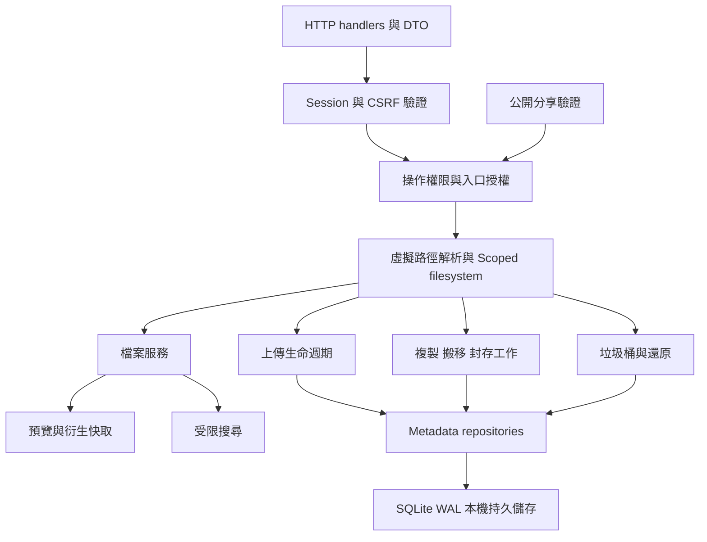
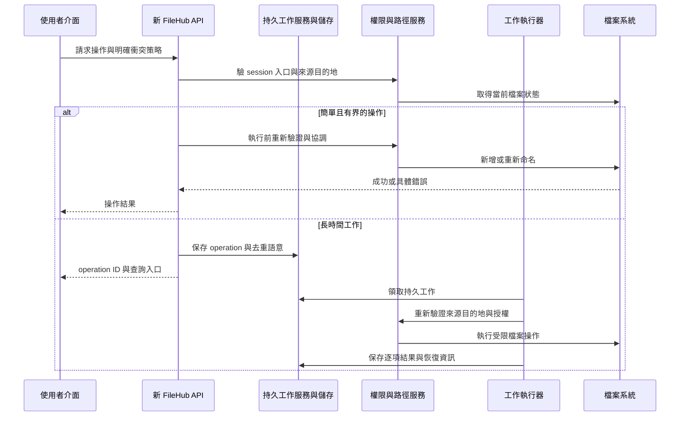

# FileHub 改寫藍圖與驗收計畫

> 驗證報告與原始擷取保留本機，未隨原始碼發佈；文中「本機」路徑僅作歷史定位，不能視為新 checkout 已有的證據。

FileHub 應借鑑 File Browser 的操作模型，重新建立符合自身權限、資料安全與介面方向的實作。先完成安全的登入與唯讀工作空間，再加入可復原的寫入、可靠上傳、預覽及長時間工作；每個階段都有可操作的成果及明確驗收條件。

本篇保存改寫行為需求與驗收規劃，不另維護第二套進度。P0 工程基線驗證見 P0.7（本機 `../validation/P0.7.md`），後續版本／已完成能力及最新驗證依[根 README](../../README.md)與[主計畫](../../IMPLEMENTATION_PLAN.md)。既定 Node／TypeScript／Fastify、Vitest／Playwright、React／Ant Design 與雙服務架構不變；工具見[定案](../toolchain-recommendation.md)，工程與流程依 [ARCHITECTURE](../../ARCHITECTURE.md)、[CONTRIBUTING](../../CONTRIBUTING.md)。下文是跨階段需求，不代表所有功能已實作。

已確認儲存需求：同時支援由 FileHub 上傳與管理的內建儲存，以及外部既有資料夾／NAS／NFS；後者可能被其他程式修改。兩者共用入口與授權模型，外部檔案的存在、名稱與內容仍以檔案系統實際狀態為準。API／worker 各一個實例，共用本機 SQLite state volume；DB／WAL／SHM 不放外部網路掛載。

## 1. 先建立行為契約

| 主題 | File Browser 已確認行為 | FileHub 建議 |
| --- | --- | --- |
| 應用殼層 | 功能側欄、固定頁首、麵包屑、動態操作；側欄不是目錄樹 | 保留一致殼層，若需要目錄樹另建導航區，不混淆帳號功能與檔案層級 |
| 檔案檢視 | list／mosaic／gallery 共用資源與選取狀態 | P8 依實際畫面建立列表／橫向圖磚／大圖庫三種模式；共用資源與選取，舊偏好保留，契約／migration 依主計畫 P8.3 |
| 登入 | JWT 在 localStorage／JS cookie，沒有伺服器 session 撤銷 | 建立可撤銷的 session、HttpOnly cookie 與寫入請求防護 |
| 檔案範圍 | 伺服器 root 加每人 scope／rules，分享範圍再縮小 | 集中解析虛擬入口與相對路徑，每項操作都驗證來源及目的地 |
| 刪除 | `RemoveAll`，直接永久刪除 | 預設移至垃圾桶，將永久刪除拆成獨立權限與明確操作 |
| 批次 | 前端逐檔 Promise，可能部分完成 | 長時間工作有 operation ID、逐項結果、重試／取消語意 |
| 上傳 | TUS tracking 與最終檔案直接連動 | 將暫存、完整性驗證、finalize 與清理納入獨立生命週期 |
| 分享 | 公開入口與分享根範圍、密碼／期限／撤銷 | 等一般帳號權限穩定後再加入；每次公開請求重新驗證有效性 |
| 搜尋 | 受 scope／rules 限制的遞迴名稱搜尋、逐行 JSON | 明確區分目前目錄篩選與遞迴搜尋；可取消且有限制 |
| 設定 | 使用者偏好、帳號、分享、全域設定分區 | 保留職責分區，以權限決定可見及可修改的項目 |

來源依據見 [02](02-ui-style-and-layout.md)、[03](03-backend-and-api.md)、[04](04-user-flows-and-state.md)、[05](05-security-and-rewrite-boundaries.md)，核心操作實測見 [06](06-runtime-evidence.md)。上表的 FileHub 欄是新設計，不是原專案已有功能。

### FileHub 舊版可供比對的需求

清空前的 [FileHub README，commit 77b606b](https://github.com/HsinPu/FileHub/blob/77b606bb9bd552a00c5e13c3dc16571623548565/README.md)曾記錄多目錄授權、伺服器 session、垃圾桶、背景複製搬移、資料夾上傳與 ZIP 任務。這些是歷史版本的功能描述，不代表新儲存庫仍有程式可用。改寫時應把它們列為需求比對項，避免因參考 File Browser 而無意間退回單純 scope、永久刪除或無工作紀錄的模型。是否全部納入新版本，仍需依產品範圍逐階段決定。

## 2. 建議的頁面與元件邊界

| 區域 | 建議責任 | Ant Design 對照 |
| --- | --- | --- |
| AppShell | 主導覽、頁首、帳號選單與路由出口 | Layout、Menu、Dropdown、Breadcrumb |
| FileWorkspace | 目前入口／路徑、檢視模式、路由同步 | Flex、Space、Tabs（有需要才使用） |
| FileToolbar | 搜尋、篩選、選取摘要與主要動作 | Input.Search、Select、Button、Dropdown |
| FileListing | 顯示資源、排序、分頁、選取；不處理所有 API | Table、Checkbox、Tooltip、Empty |
| FolderNavigation | 若採目錄樹，逐層載入與導航 | Tree、Spin；手機放 Drawer |
| FilePreview | 檔案型別分流、載入限制、下載 fallback | Drawer 或專用頁；媒體 renderer 分模組 |
| OperationDialogs | 新增、改名、目的地、衝突選擇與刪除確認 | Form、Modal、Popconfirm、TreeSelect |
| UploadPanel | 逐項狀態、進度、錯誤與重試 | Upload 作為入口、Progress、List、Alert |
| TaskPanel | 批次工作、ZIP、逐項結果、取消狀態 | Drawer、Table、Tag、Progress |
| Settings | 個人、入口／權限、帳號、分享管理 | Tabs／Menu、Form、Table、Switch |

上傳元件不能取代上傳協定與任務狀態；Table 的 client pagination 也不能解決後端一次讀完整個大目錄的問題。先決定資料契約，再選元件。

主題以 `ConfigProvider` 集中設定。2026-10-30 使用者改以 File Browser 全部主要畫面為視覺依據，最新方向見根目錄 [DESIGN.md](../../DESIGN.md)與[全畫面審查](../reviews/filebrowser-visual-reference.md)。CSS／字體／Material 圖示可依各自適用授權取用並改寫為 React，實際資產需保存來源、修改及聲明；全域移除 outline、側欄溢位與無對應功能的控制不移植。進度僅依[主計畫 P8](../../IMPLEMENTATION_PLAN.md#p8-file-browser-畫面還原)，本篇不另維護工作狀態。

## 3. 建議的狀態模型

| 狀態 | 建議擁有者 | 更新規則 |
| --- | --- | --- |
| 入口、路徑、排序、可分享的篩選 | URL 與工作空間 controller | 重新整理可恢復；不要只存在不可分享的 global state |
| 登入者、能力、有效 session | Session provider／server | 前端只使用公開資料；權限真值在後端 |
| 目錄查詢與快取 | Query layer | key 至少含入口、canonical path、sort／cursor；切換目錄取消舊請求 |
| 選取 | 目前列表 controller | 使用穩定資源識別；目錄改變、項目刪除後移除失效選取 |
| 對話框表單 | 對話框元件 | 開啟帶入 context；關閉／成功後清理；避免將多步流程塞進一個全域 prompt |
| 檔案剪貼簿 | 工作階段內的專用 store | 保存來源入口、路徑及 copy／move 語意；貼上時重新授權與驗衝突 |
| 上傳 | Upload controller＋伺服器 upload session | UI 切頁不丟進度；重新整理後可否恢復由明確契約決定 |
| 長時間工作 | 伺服器 operation record | UI 可重連查詢；`partial` 與 `cancelled` 不渲染成全部成功 |

一般查詢採 `idle → loading → success／empty／error`；保留上一個資料時必須標記正在更新，不能將舊目錄結果當成新路徑。每次完成 callback 檢查 request identity，避免較慢的舊請求覆寫新狀態。

## 4. 建議的後端模組與資料

這是 Node.js 模組化單體內的職責，不要求拆成微服務。Fastify routes／hooks 呼叫 application services，服務經 filesystem／SQLite adapters 操作資源；公開 DTO 與 schemas 放在 `packages/contracts`。`app.ts` 工廠、API 的 `server.ts` 與 worker 的 `worker.ts` 啟動入口分離，兩服務使用相同 image，詳見 [ARCHITECTURE.md](../../ARCHITECTURE.md)。

| 實體 | 最低必要資訊與用途 |
| --- | --- |
| User | 帳號、密碼雜湊、角色、啟用狀態與時間戳 |
| Session | 不可直接使用的 session identifier digest、user、expires、revoked、必要的更新版本 |
| Mount／EntryPoint | 穩定 ID、顯示名稱、主機根路徑（不回傳一般使用者）、啟用狀態 |
| Grant | user／role、入口、相對 scope、browse／download／create／modify／rename／delete 等能力 |
| Operation | 類型、發起者、狀態、來源／目的地、idempotency key、建立與完成時間 |
| OperationItem | 單項結果、已完成步驟、錯誤類別及可否重試；不可只存整批 success |
| UploadSession | 擁有者、目的地、暫存位置、宣告大小、已寫 offset、到期與 finalize 狀態 |
| TrashItem | 擁有者、原入口／路徑、回收位置、刪除時間、還原限制 |
| Share | owner、來源資源識別、secret digest／密碼雜湊、期限、撤銷及允許動作 |

實際檔案系統仍是內容的來源，不需要第一版就把每個檔案索引成完整資料庫目錄。衍生縮圖快取與暫存上傳應可重建、可清理，不能當成永久原檔。跨 DB 與檔案系統的副作用需要可恢復狀態，不能假設一次 SQL transaction 能原子完成檔案搬移。

## 5. 建議的 API 契約草案

以下保存新 FileHub 初期的 API 候選命名，不是 File Browser 的既有 endpoints，也不是目前可直接呼叫的端點清單。正式版本已採 [contracts](../../packages/contracts/src/index.ts)與 [Fastify 模組 routes](../../apps/server/src/app.ts)，例如 `/api/session`、`/api/entries/:entryId/files`；下表的 `/api/v1/*` 草案沒有以相同名稱發布。功能落地與契約差異依[驗收準備稽核](../reviews/acceptance-readiness-2026-11-01.md)，不因早期命名不同就判定功能缺失。

| 領域 | 草案 | 契約要點 |
| --- | --- | --- |
| 登入 | `POST /api/v1/login`、`GET /api/v1/session`、`DELETE /api/v1/session` | Cookie 與 server-side revocation；回應不帶可供 JavaScript 持久保存的 bearer token |
| 入口 | `GET /api/v1/entries` | 只回傳可見入口、公開狀態與能力，不暴露主機路徑 |
| 列表 | `GET /api/v1/resources?entryId=...&path=...&sort=...&cursor=...` | 明確排序、大小上限與分頁語意；篩選和遞迴搜尋分開 |
| 新增／改名 | `POST /api/v1/directories`、`POST /api/v1/rename` | 結構化 entry／path、名稱驗證、預期版本／衝突策略；成功回新 identity |
| 複製／搬移 | `POST /api/v1/operations`、`GET /api/v1/operations/:id` | 建立工作後以 operation ID 查詢；逐項結果、部分成功、取消與重試 |
| 上傳 | 建立、查 offset、傳 chunk、finalize、cancel 的 upload-session 契約 | 若選 TUS 就遵循其協定，避免把自行定義的 finalize 假裝成標準 TUS 行為 |
| 垃圾桶 | 建立 trash operation、查項目、還原、獨立永久刪除操作 | 還原到原位置與另選位置均重新授權；衝突不能靜默覆寫 |
| 預覽／下載 | metadata、原始串流、縮圖各自 endpoint | Range、Content-Disposition、大小限制、cache identity 與 MIME 安全 |
| 分享 | 建立／列出／撤銷，以及獨立公開存取入口 | 每次存取驗期限、撤銷及資源範圍；密碼與 secret 不寫入一般 log |

錯誤回應統一包含可供 UI 判斷的 `code`、可呈現的 `message`、非機密的 `details` 及 `requestId`。例如名稱衝突與權限不足要有不同 code；HTTP 成功也不能隱藏 operation 內的部分失敗。

### 寫入檢查與背景工作分流

新增資料夾與一般單檔改名採有界同步請求；遞迴複製、跨磁碟搬移、ZIP 及大型批次操作才建立持久 operation。兩條路徑都在執行前重新驗證授權、路徑與衝突，不能只依賴前端預檢。同步操作仍保留必要稽核，不要求每次改名都排入背景佇列。

前端預檢只改善使用體驗；名稱、檔案版本或目的地可能在預檢後改變。伺服器必須處理競態及失效授權。使用何種鎖、平台檔案 API 與暫存發布方式，需以預定支援的 Windows／Linux／NFS 實測，不寫成通用保證。

## 6. 分階段實作與提交

後續實作以根目錄 [IMPLEMENTATION_PLAN.md](../../IMPLEMENTATION_PLAN.md) 為主計畫。該文件將以下階段拆成有編號的工作，列明修改位置、參考文件／原碼、驗收與目前狀態；進度只在主計畫維護，本篇保留行為需求與階段概覽。

| 階段 | 可交付的切片 | 該階段完成條件 |
| --- | --- | --- |
| P0 契約與骨架 | 依定案版本建立 pnpm workspace／lockfile，固定其餘依賴與平台邊界；建立 Drizzle schema／已審 SQL migrations、Fastify 工廠、同 image 雙服務啟停、SQLite WAL 與公開 contracts、Vitest／Playwright fixtures | 乾淨安裝與實際 SQLite 版本核對；migration 成功才啟 API／worker；file-backed WAL、獨立連線與雙程序 smoke、DB 還原、inject／真實 HTTP、型別／build 通過；實際 scripts 與文件一致 |
| P1 登入與唯讀瀏覽 | 可撤銷 session、入口授權、列表、麵包屑、排序、基本手機導覽 | 一般使用者不能越權；深連結／重新整理可恢復；舊查詢不覆寫新路徑 |
| P2 安全寫入 | 新增、改名、衝突處理、移至垃圾桶與還原 | 來源／目的地均驗權限；同名不默默覆寫；錯誤與部分完成可理解 |
| P3 可靠上傳 | 佇列、進度、取消、重試、upload session、暫存與 finalize | 斷線／過期／重啟策略明確；失敗檔不冒充完整原檔；容量有限制 |
| P4 檢索與內容 | 目前目錄篩選、受限遞迴搜尋、圖片／文字／PDF 預覽 | 大小與型別限制、下載 fallback、無權檔不進搜尋／縮圖 |
| P5 長時間工作 | 複製／搬移／封存、SQLite 持久工作領取、lease、工作查詢與逐項結果 | API／worker 跨程序協調；失效 owner 不更新狀態；在途副作用先確認停止再恢復；UI 切頁可回查，取消／重試與跨裝置情境已測 |
| P6 分享與維運 | 分享期限／密碼／撤銷、帳號設定、健康／就緒、備份流程 | 公開邊界與撤銷有效；備份包含 DB、原檔及必要設定；還原演練成功 |

每一階段仍拆成小份提交：先寫可驗證的行為，再實作對應切片，執行適用測試並檢查 staged diff，提交後再做下一片。程式變動依專案版本規則更新 SemVer；只修研究文件不增加應用程式版號。未授權前不 push、不部署，也不把本藍圖視為要求立即開始寫程式。

測試依 [CONTRIBUTING.md](../../CONTRIBUTING.md) 分層：正式功能驗證需使用適用的隔離 FS／SQLite adapter、file-backed DB 及雙程序；Fastify.inject 不代表真實 TCP，Playwright 與 NFS／跨磁碟／程序故障另驗。P0.1 只通過本機工具鏈案例，不能將本篇未實作的功能驗收當成已通過。

## 7. 跨階段驗收清單

| 類別 | 必須覆蓋的具體情境 |
| --- | --- |
| 登入連線 | 錯誤密碼、到期、登出後舊 session、停用帳號、修改密碼後撤銷、重複 renewal |
| 權限 | 沒有入口／只有瀏覽／可下載／可建立／可刪除；來源與目的地權限不同；工作中權限被撤銷 |
| 路徑 | `..`、多次編碼、分隔符差異、絕對路徑、符號連結／junction、dangling link；執行中替換依 P0 明定的本機威脅模型判定支援範圍 |
| 列表 | Unicode／長檔名、空目錄、大目錄、穩定排序、分頁後多選、快速切換目錄、無法存取入口 |
| 寫入 | 同名、大小寫差異、來源消失、目的地已變更、複製到自身子目錄、跨磁碟、磁碟滿、程序中斷 |
| 上傳 | 小／大檔、同名、取消、斷線、錯誤 offset、重送 chunk、到期、重啟、清理與 finalize 競態 |
| 批次 | 第一項成功後第二項失敗、取消時已有完成項、重試既有 operation、逐項錯誤與進度一致 |
| 垃圾桶 | 還原原位置、同名衝突、改權限後還原、另選目的地、資料庫與檔案不一致的恢復 |
| 分享 | 未登入存取、錯誤密碼、到期、撤銷、來源移動／刪除、子路徑越界、權限／owner 狀態改變 |
| 預覽 | 不支援型別、超大檔、損壞圖片／PDF、HTML／SVG／Markdown 處理、Range、快取失效與授權隔離 |
| 介面 | 1440px 桌面、800px 平板、390px 手機；側欄內部溢位、長標題、浮層、工具列、Tab／Enter／Esc、焦點回復 |
| 維運 | 一個 API 與一個 worker、同 image 版本、SQLite WAL／busy handling、一次性 migration、readiness 與外部入口狀態分離、兩服務停止／備份／還原；擴增實例另立決策 |

本清單的已落地契約、測試對照及保留環境界線已集中在 P6 矩陣（本機 `../validation/P6-matrix.md`），當次結果見 P6.4（本機 `../validation/P6.4.md`），進度依[主計畫](../../IMPLEMENTATION_PLAN.md)。固定 session 無 renewal、切頁清選取等差異依已定案契約說明，不虛構未提供的能力。01–06 的來源實測與原始證據保留歷史條件，不能當作新版或任意部署平台已通過。
